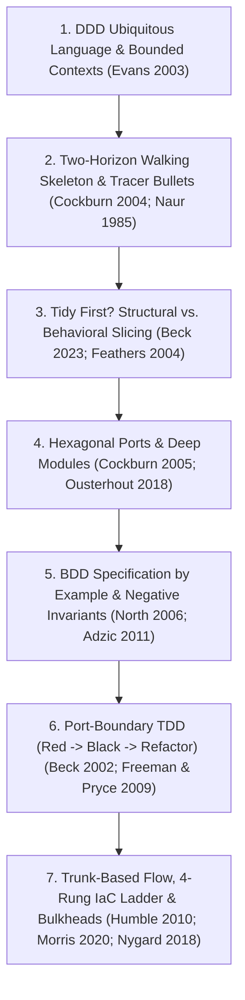

# Volume 1: The 7 Lenses, Theoretical Foundations, Idiomatic Matrix & Anti-Gaming Catalog

> **Scope:** Deep analysis of the multi-lens evaluation frameworks, systems-theory equations, polyglot idiomatic laws, and anti-reward-hacking controls encoded across our skills, reviewers, and CLI gates.

---

## 1. Systems Theory & Empirical Foundations

Our agentic harness is built on two empirical laws from software delivery research (*Accelerate*, Forsgren et al. 2018; DORA 2024/2025) and systems theory (Goldratt *The Goal* 1984; Meadows *Leverage Points* 1999):

1. **AI amplifies existing engineering discipline; it does not replace it.** On teams with small batches, fast deterministic feedback, and clear modular ports, AI increases throughput and stability. On teams without them, AI accelerates drift, oversized diffs, and rework.
2. **Tribal context is the bottleneck (Theory of Constraints Step 4 — Elevate).** In complex systems, typing speed is never the constraint; the constraint is architectural and operational invariants trapped in one engineer's head (the *"Brent"* pattern from *The Phoenix Project*).
   - Adding review reminders operates at **Meadows Leverage Point #12 (Parameters — lowest leverage)**.
   - Encoding ubiquitous language, code-anchored corpus rules, and deterministic compute kernels operates at **Leverage Point #6 (Structure of Information Flows)** and **Leverage Point #2 (Shared Paradigms)**.

---

## 2. The Four Multi-Lens Frameworks

Our tooling uses four distinct, complementary lens frameworks at different stages of the engineering lifecycle:

### 2.1 The 7 Architectural Design Lenses (`software-design` & `deep-modules`)

Every non-trivial design or refactor is evaluated across **7 Architectural Lenses** before implementation:

| Lens | Core Principle & Primary Literature | Mechanical Rule & Anti-Pattern Blocked |
| --- | --- | --- |
| **Lens 1: DDD Bounded Contexts & Ubiquitous Language** | One canonical owner per capability; explicit Anti-Corruption Layer (`ACL`) at context boundaries (Evans 2003; Vernon 2013). | Enforces sourced domain nouns, closed capability verbs (`harden`, `lint`, `test`, `install`, `build`, `configure`, `deploy`, `scan`, `export`, `create`, `get`), and a forbidden `_Avoid_` synonym list. |
| **Lens 2: Deep Modules & Information Hiding** | Module depth = $\frac{\text{Functionality Hid}}{\text{Interface Complexity}}$ (Ousterhout 2018). **Define errors out of existence** via idempotent/declarative state (`state: present/absent`). | Rejects shallow pass-through wrappers, 1:1 variable forwarders, and temporal call-order coupling. Requires **Design It Twice** (Alternative A: minimal interface vs. Alternative B: caller flexibility) and **4-Category Seam Classification** (*In-process*, *Local-substitutable*, *Remote-but-owned*, *True external*). |
| **Lens 3: Hexagonal Ports & Adapters + Functional Core / Imperative Shell** | Pure deterministic logic over immutable in-memory snapshots (`core`); thin I/O adapters at the edges (Cockburn 2005; Bernhardt 2012). | Domain logic never imports subprocess, HTTP, CLI parsing, or wire-format libraries. Requires **two real adapters** (or a concrete external/test boundary) before introducing a generalized port trait/interface. |
| **Lens 4: Reuse / Native Builtin / Approved Crate-Library First (Anti-NIH Gate)** | Check in strict order: **Tier A** (language stdlib / declarative builtin) $\to$ **Tier B** (approved workspace crate/library) $\to$ **Tier C** (toolchain binary) before writing custom code. | Blocks hand-rolled regex parsers, shell polling loops, or custom data structures (`stdlib:` / `builtin:` / `delete:` / `inline:` / `flatten:` tags). Requires **Isomorphism Proof** and **Opportunity Matrix $\text{Score} \ge 2.0$**. |
| **Lens 5: Zero-Token Data Plane & 3-Locus Compute-Kernel Split** | Keep the LLM out of the hot data path (Hightower / Ruff / Tricorder). Compile probes, joins, and AST transforms into a single tool returning a `<= 2 KB` decision pack. | **Anti-Relay-Race Rule:** At most **one** diff/validation planner per locus (`TypeScript tool -> bash -> Python -> Rust` must not each re-run `git diff`). Leaf checkers accept explicit file lists. |
| **Lens 6: 5-Point Systems & Data-Layout Contract (`SYS-01..05`)** | Stream-oriented sparse JSONL/WAL, raw-slice SIMD pre-filtering, single-pass shard folds, commit-barrier `fsync()`, and $O(1)$ metadata resume. | Blocks monolithic JSON arrays (`>100` items), doubly-escaped JSON-in-JSON strings, parse-before-filter waste, unbounded regexes (`> 4 KiB`), and per-item `fsync()` inside loops. |
| **Lens 7: Teammate Fungibility, Path Rationalization & CLI Ergonomics** | Every tool works identically on any laptop via `make install` without machine-specific paths or snowflake state. | Enforces `ConfinedPath` / `Path.resolve().is_relative_to(root)`, `.DEFAULT_GOAL := help`, `--doctor [--json]`, `--fix`, `--undo`, and strict `stdout` (data) vs. `stderr` (diagnostics) separation. |

---

### 2.2 The 7-Step `*DD` + XP + DevOps Operational Spine

Key operational mechanics along this spine:
- **Two-Horizon Walking Skeleton (Countering AI BDUF / *"Confluslop"*):** When an agent pre-scripts `PR 1..10` upfront before `PR 1` lands, it destroys **Peter Naur's *Programming as Theory Building*** (1985). Issues therefore commit to **Horizon 1** (one immediate next PR slice with concrete Gherkin) while keeping **Horizon 2** as revisable `tentative:` hypotheses and `Open question:` items. After each PR lands, learned `path:line` truths are **folded back** into `
` drawers on the tracking issue.
- **Boundary Counterexamples (Adzic 2011):** Every positive `Given -> When -> Then` scenario must pair its positive observable outcome with an explicit **negative/boundary invariant** (*`without <unwanted side effect>`*, e.g. *"without draining active worker nodes"*, *"without network egress"*).
- **Feathers Characterization Pinning (Feathers 2004):** Before splitting, extracting, or deleting legacy code/playbooks, inventory every state mutation (files, services, kernel params, cluster objects, exported symbols) and map each to its surviving owner so zero side effects are orphaned.
- **4-Rung Infrastructure-as-Code Feedback Ladder (Morris 2020):**
  - **Rung 1 (`< 2s`):** Static AST / YAML / drift / packet lint (`ao` / `pal` / `autonomy_preflight`)
  - **Rung 2 (`< 5s`):** Port seam dry-run (`--syntax-check`, `--list-tasks`, `helm template`, `cue vet`)
  - **Rung 3 (`1–3m`):** Local container / Molecule / snapshot-backed libvirt VM lab contract check
  - **Rung 4 (`CI / Runtime`):** Merge-request pipeline and live cluster reconciliation.

---

### 2.3 The 4 Adversarial Code-Review Lenses & 3-Pass Convergence (`software-review`)

Every code/config diff is audited across four orthogonal adversarial lenses, followed by the **3-Pass Convergence Rule** (after any fix commit, re-run preflight + review lenses until a pass produces **zero new findings**):

1. **`implementation-risk`:**
   - Uncaught `OSError` (`ENOENT` / `ENOEXEC`) when invoking subprocesses (catching only `SubprocessError` misses missing-binary failures).
   - Command-substitution `stdout` pollution (`var="$(helper_func)"` where `helper_func` runs package managers or builds without redirecting logs to `>&2`).
   - Silent fallback version mismatches and unpropagated `--offline` / environment overrides to child processes.
   - Shared receipt aliasing (multiple distinct binaries writing to the same `.cli-sha` stamp file).
2. **`docs-consistency`:**
   - Exact parity between `Makefile` `help:` target descriptions and actual recipe behavior.
   - Exact parity between `README.md` / `SKILL.md` flag claims (`--doctor` read-only vs `--doctor --fix`) and compiled CLI `--help` / `capabilities --json`.
3. **`security`:**
   - **CWE-22 Sibling-Prefix Bypass:** Rejects `path.startswith(root_prefix)` and `os.path.commonprefix` (where `/repo-evil` matches `/repo`); requires component-aware `Path.resolve().is_relative_to(root)` in Python, `clean + "/"` in TS/Go, or `ConfinedPath` + `O_NOFOLLOW` in Rust.
   - **Untrusted JSON Root Validation:** Rejects `JSON.parse` / `json.loads` assumed to be an object without checking `isinstance(cfg, dict)` (since `"true"`, `123`, or `[]` are valid JSON roots).
   - **Token-on-Stdin:** Forbids passing bearer tokens or passwords on command-line argv (`curl -H "Authorization: ..."` exposes secrets in `/proc/<pid>/cmdline`); requires `curl --config -` over `stdin`.
4. **`test-signal`:**
   - Verifies `@test` / `test_*` bodies actually pass the flags claimed in their test names.
   - Verifies mock binaries (`fake_bin/curl`, etc.) assert stdin and auth headers rather than discarding stdin via `cat >/dev/null`.

---

### 2.4 The 4 Spike-Audit Lenses (`audit-spike`)

When auditing an engineering spike or design proposal before team adoption, 15 rules across 4 lenses separate **validated facts** from **plausible-looking AI assertions** (7 deterministic CLI rules + 8 agent-judgment rules):

| Lens | Rule IDs & Severity | What It Detects |
| --- | --- | --- |
| **Lens 1: Validated-vs-Asserted *(Load-Bearing; Run First)*** | `VA-1` (`BLOCK`), `VA-2` (`BLOCK`), `VA-3` (`WARN`), `VA-4` (`WARN`) | `VA-1` mechanically blocks words like *"proven / validated / confirmed / works"* when backed by zero execution receipts or validation rungs. `VA-2` blocks unverified enclave/network/credential assumptions presented as fact. `VA-4` quarantines "multi-model duel agreement" hype out of team issues. |
| **Lens 2: Snippet Accuracy = Facts Accuracy** | `SA-1` (`BLOCK`), `SA-2` (`BLOCK`), `SA-3` (`WARN`) | `SA-1` blocks HCL/Rego/Ansible/Bash/Python snippets that do not parse or match real provider schemas. `SA-2` blocks references to undefined variables/outputs. `SA-3` requires every snippet to be labeled `grounded (file:line)` vs `illustrative/greenfield`. |
| **Lens 3: Decision Quality** | `DQ-1` (`BLOCK`), `DQ-2` (`WARN`) | Ensures irreversible one-way-door trade-offs name rejected alternatives, concrete failure modes, and the probe that would overturn the choice. |
| **Lens 4: Shape & Canon** | `SC-1..4` (`BLOCK` / `WARN`) | Enforces 15-second cold-read structure, `
` progressive disclosure for deep evidence, and ubiquitous language alignment. |

---

## 3. The 8-Language Idiomatic & Reuse-First Matrix

Law 2 of our delivery standard forbids **transliterated code** (writing Python/Go pointer-chasing maps in Rust, writing Bash pipelines inside declarative config modules, or writing regex line-scanners over source code when an AST parser exists):

| Language / Surface | Forbidden Transliterated Anti-Pattern | Idiomatic Requirement | Required Reuse-First Primitives |
| --- | --- | --- | --- |
| **1. Rust** | `BTreeMap<String, _>` in hot lookup loops, `.clone()`/`.to_string()` in loops, untyped `serde_json::Value` DOM trees, `Regex::new` inside functions, `Command::new("git")` in loops | `#[repr(transparent)]` newtypes (`FileId(u32)`, `NodeId(u32)`, `ConfinedPath`), `#[repr(u8)]` exhaustive enums, `FxIndexMap` ($O(1)$ lookup + `.sort_unstable_keys()`) or sorted `Vec` ($N \le 100$), `&str`/`Cow`/`SmolStr`, `LazyLock` automata | `aho-corasick`, `memchr`, `bstr`, `globset`, `rustc-hash`, `indexmap`, `smallvec`, `smol_str`, `camino`, `petgraph`, `fixedbitset`, `similar`, `thiserror`, `rustix` |
| **2. Python 3.12** | Line-by-line regex parsers over Python/YAML/Bash, `.startswith(prefix)` path checks (`S-PY5`), `.get(k, [])` fail-open validators (`S-PY2`), catching `SubprocessError` without `OSError` (`S-PY6`) | `@dataclass(frozen=True)` / `TypedDict` / `Enum`, `ast.NodeVisitor` for Python static checks, `Path.resolve().is_relative_to(root)`, package-per-tool with `1:1` `tests/test_<mod>.py` (`S-PY4`) | Stdlib `ast`, `pathlib`, `urllib.parse`, `shlex`, `tomllib`; `ruamel.yaml`, `jsonschema`, `pytest`, `mypy --check-untyped-defs` |
| **3. TypeScript (Extensions)** | `as any` casts, unvalidated `JSON.parse` roots, single-canary receipt checks, throwing in event hooks without `ctx.abort()` | Discriminated unions, TypeBox `Value.Check` runtime schema guards, cross-field completeness assertions, `Symbol`-branded frozen receipts, mode-gated registration | TypeBox, Node `execFile` (shell-free), `crypto.createHash('sha256')`, QuickJS sandbox |
| **4. C++17 (Real-Time / Autonomy)** | Uninitialized primitive/pointer members (`BA104`), asymmetric mutex lock/unlock across callbacks & timers (`BA103`), `std::stoi`/`stod` without exception handling (`BA102`), `using namespace` in headers (`BA106`), publishing inside constructors | In-class member initializers (`= 0`, `= nullptr`), RAII lock guards with snapshot-under-lock + publish-outside-lock, pure handler core + thin middleware adapter, deterministic RNG seed consumption | `ast-grep`, `cppcheck`, CTest slice runner, headless GDB batch backtraces |
| **5. CUE & Declarative Config** | Hardcoding concrete values in base schemas where platform overlays override (`_|_` unification conflict), letting generated K8s Indexed Job names exceed 63-char DNS-1123 limits (`BA401`) | Default unification (`*"NONE" \| string`, `*10 \| int`) in base configs, 5-platform overlay key parity (`BA203`), byte-for-byte C++ macro $\leftrightarrow$ IDL $\leftrightarrow$ CUE port parity (`BA204`), `job_name <= 41` chars | `cue vet`, `cue export`, AST/CUE port-parity checker |
| **6. Declarative Infra (Ansible / Helm)** | Bash pipelines inside `command:`/`shell:`, `stdout` string parsing in `until:`, `set_fact` procedural state machines, copy-pasted values across staging/prod, Helm `postRenderers` when native chart values exist | Declarative builtin modules first, `command.argv` list form when CLI required, `block/rescue/always` cleanup, single canonical `group_vars/all` definition + sibling-env parity | `ansible.builtin.{uri,wait_for,systemd_service,stat,file,template}`, `kubernetes.core.k8s`, `helm lint --strict` |
| **7. CI/CD Pipelines** | Copy-pasted inline `script:` blocks without template inheritance, environment-suffixed duplicate jobs (`_staging`/`_prod`), floating `:latest` tags, broad `rules:changes: ["**/*"]` | `.dot-template` is the Port; job in `.gitlab-ci.yml` is the thin Adapter (`extends:`); explicit `needs:` DAG edges; diff-scoped rules | YAML anchors/`extends:`, `!reference [...]`, pinned digest images |
| **8. Bash / Makefile / Bats** | `>100`-line data/JSON processing in Bash, stdout pollution inside `$(...)`, `Makefile` `help:` drifting from recipes, test mocks discarding stdin | Thin imperative shell (`set -euo pipefail`); delegate structured logic to Rust/Python; redirect subshell logs `>&2`; `.DEFAULT_GOAL := help` | `jq -e`, `shellcheck`, `bats`, `flock`, `mktemp -d` + `trap`, `curl --config -` |

---

## 4. The Anti-Gaming & Reward-Hacking Catalog (`RH-1..17` & `PL-1..5`)

Encoded in `just-say-no-to-process-porn-and-ceremony` and enforced mechanically by `oracle-gate.ts` and `check-evidence.ts`:

### 4.1 The 4-Part Creation Gate (Blocking Process Porn & *"Confluslop"*)
Before creating **any** non-code artifact (ledger, dashboard, status matrix, meta-report, schema, or multi-slice roadmap), the author must name:
1. **Consumer:** Exact runtime binary, reviewer, or ship-gate script that reads and branches on it.
2. **Gate:** The product capability that cannot ship without it.
3. **Observed Defect:** Concrete historical bug or incident SHA that justifies it.
4. **Retirement Trigger:** Exact condition under which the artifact will be deleted.
*If any of the 4 is missing, the artifact is dispositioned as `PARK` and blocked.*

### 4.2 Reward-Hacking Failure Modes (`RH-1..17`) & Mechanical Defenses
- **`RH-1` (Gate / Oracle Self-Weakening):** Deleting assertions, loosening tolerances, adding `@pytest.mark.skip` / `#[ignore]`, or editing linter scripts in a feature commit. *Blocked mechanically by `oracle-gate.ts` (`auditDiffAgainstContract`) and `candidate-integration.ts` (which audits every intermediate commit in a branch so an agent cannot delete a test in commit 1, pass a check, and restore it in commit 2).*
- **`RH-2` (Golden / Snapshot Regeneration without Cause Proof):** Overwriting golden fixtures (`--update-snapshots`) to silence a regression. *Blocked by protected-oracle path rules.*
- **`RH-3` (Tautological / Vacuous Tests):** Writing `assert True` or asserting that an empty input list produced zero errors (vacuous pass). *Countered by requiring a positive observable assertion + minimum-input coverage check + planted negative invariant.*
- **`RH-4..9` (Refusal Farming & Scope Laundering):** Closing a slice after implementing only the guard/refusal path (`if bad: return Err`) while leaving the positive capability unimplemented, or splitting in-scope acceptance criteria into follow-up tickets to claim completion.
- **`RH-10..17` (Denominator Omission & Metric Cherry-Picking):** Reporting `"100% pass rate"` or `"3x speedup"` while omitting skipped/censored runs, cold-start overhead, or $p95/p99$ tail latencies.

### 4.3 Proof-Laundering Controls (`PL-1..5`)
- **`PL-1` (Exact Test-Set Equality):** Verification must run the exact declared `check_commands[]` on the exact `(base_sha, head_sha, tree_sha)`.
- **`PL-2` (Positive Observable Proof):** Every pass receipt must include at least one positive behavioral test, never only lint/compile or refusal checks.
- **`PL-3` (Proof-Config Binding):** The SHA-256 `contract_digest` binds repo root, normalized acceptance, write scope, and ordered check commands into a `Symbol`-branded `TrustedManagedCheckReceipt`.
- **`PL-4` (Readiness != Promotion):** Local check green never authorizes remote push, merge, or live deployment (`promotion-gate`).
- **`PL-5` (Author-Distinct Judge):** `validate` runs in a fresh subagent context that did not author the candidate and cannot be satisfied by prose claims.
