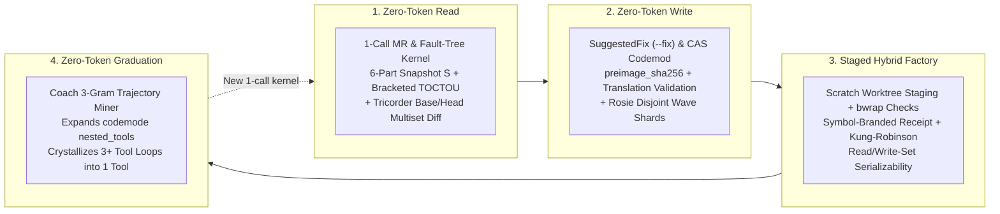

# Volume 3: Zero-Token Data Plane, QuickJS/WASM Codemode Sandbox & OS Confinement

> **Scope:** Deep architectural analysis of the 4-stage Zero-Token Data Plane (`Read -> Write -> Staged Factory -> Graduate`), the QuickJS `codemode` in-sandbox execution engine, Linux `bwrap` namespace isolation (`Regulated` vs. `Commercial Lockdown`), provider egress abort ordering, and the FNV-1a sliding-window loop guard.

---

## 1. The Zero-Token Data Plane Architecture

### 1.1 The Core Problem: LLM-in-the-Data-Plane Tax
In first-generation agent harnesses, the LLM sits in the hot data loop:
- It runs 10–15 sequential read/grep/CI/log tool calls to assemble state, paying `10k–40k` input tokens per turn.
- It copies commit SHAs, pipeline IDs, and pod UIDs across turns in natural language (risking transcription hallucinations and TOCTOU drift).
- It repairs mechanical lint findings across 20 files via freehand `edit` tool calls.

### 1.2 The 4-Stage Zero-Token Loop (`Read -> Write -> Staged Factory -> Graduate`)

#### Stage 1: Zero-Token Read (1-Call Snapshot-Bound Probe & Join)
Instead of multi-turn polling, a single tool call (`mr_validate` + `pal validate`) binds all state to an immutable **6-part Kung-Robinson snapshot**:
$$S = (\text{target\_project\_id},\, \text{source\_project\_id},\, \text{mr\_iid},\, \text{diff\_base\_sha},\, \text{head\_sha},\, \text{target\_tip\_sha})$$
- **Merged-Result Parentage Proof:** When a pipeline runs on `refs/merge-requests/<iid>/merge`, the kernel fetches the merge commit's `parent_ids` and verifies that `head_sha` is one parent while binding the other parent as `target_tip_sha` (`change-preflight.ts:34-96`).
- **Two-Tier Incremental Equivalence-Class Join (`136x` Speedup):** When checking key/value parity across sibling environments (`staging`, `prod`, etc.), instead of parsing all YAML files in every environment on every run, the checker computes a `rel_filter` over **changed and deleted relative paths** in the diff and evaluates only the touched equivalence classes—cutting runtime from `98,318ms` to `720ms`.
- **Bracketed TOCTOU Verification:** After all local static gates and remote CI fault-tree traversals finish, the broker re-fetches the MR metadata from the server (`change-preflight.ts:214-289`). If `head_sha` or `diff_base_sha` moved during the check window, `stale_subject: true` is set and any `PASS` verdict is deterministically downgraded to `NOT_PROVEN`.

#### Stage 2: Zero-Token Write (Preimage-Bound `SuggestedFix` & Rosie Shards)
- Linter rules emit structured **Tricorder `SuggestedFix`** records (`{path, start_line, end_line, preimage_sha256, replacement, description}`).
- Mechanical fixes apply in `< 100ms` for **zero LLM output tokens** via `--fix` or `codemod apply`, guarded by:
  1. `preimage_sha256` match against disk bytes,
  2. **Protected-Oracle Deny Policy** (`oracle-gate.ts` / `codemod.rs:81-112`), and
  3. **Translation Validation** (token-stream equivalence for formatting in `deterministic-plan.ts:30-175`; symbol-collision and post-image idempotency checks in `codemod.rs:120-219`).

#### Stage 3: Staged Hybrid Factory (Zero-LLM Multi-Shard Execution)
- `executePrecomputedDeterministicWave` (`precomputed-wave.ts:32-248`) accepts up to $N$ precomputed shard plans (e.g., 10 shards modifying 20 files), verifies global Kung-Robinson read/write-set serializability, applies all replacements in an isolated scratch Git worktree, runs `bwrap`-confined managed checks once over the union tree, mints a `Symbol`-branded `TrustedManagedCheckReceipt`, and cherry-picks into the target repo—**executing an entire multi-shard wave with 0 LLM subagent turns**.

#### Stage 4: Zero-Token Graduation (Empirical Trajectory Crystallization)
- Across 427 production sessions (`59,725` tool events), `coach report` (`report.rs:2566-2623`) mines recurring 3-step domain tool n-grams (`windows(3)`) and ranks high-friction multi-tool sequences so maintainers can crystallize them into new 1-call composite tools.

---

## 2. The QuickJS Sandbox (`codemode`) vs. OS Sandbox (`bwrap`)

Our harness uses **two distinct sandboxing technologies** for two different problems:

| Dimension | QuickJS Async VM Sandbox (`codemode` tool) | Linux Bubblewrap Namespace Sandbox (`bwrap`) |
| --- | --- | --- |
| **What Runs Inside** | Raw JavaScript orchestration scripts (`await Promise.allSettled([tools.read(...), ...])`) written by the LLM to batch, join, and filter tool calls in a single turn. | Native OS binaries (`git`, `cargo`, `pytest`, `pal`, `python3`, `bash`) invoked by the agent shell or `managed-checks.ts`. |
| **Isolation Mechanism** | Embedded QuickJS bytecode VM (same engine family used in WASM/embedded JS sandboxes) with **zero Node.js APIs, zero direct filesystem, zero network sockets, and zero ambient timers**. | Linux kernel namespaces (`--unshare-net --unshare-user --unshare-pid --unshare-uts --unshare-ipc --cap-drop ALL --die-with-parent`). |
| **Capability Surface** | Can only call registered `await tools.<name>(args)`, `store(k,v)` / `load(k)` session state, and `models`. | `Regulated` mode: full local FS bind, **zero network** (`--unshare-net`), `/tmp` masked with fresh tmpfs. `Commercial` mode: network enabled, **entire host FS masked** except confirmed workspace and allowlisted `/usr`, `/bin`, `/lib` mounts. |
| **Resource & Concurrency Caps** | Max **256 nested tool calls** per script; max **8 active concurrent calls** (excess queued automatically); **8-MiB outstanding-request budget**; **16-MiB / 100,000-call output ceiling**; configurable `timeout_ms` and `max_output_tokens`. | Per-command wall-clock timeout, process-group kill (`process_group(0)`), and 50-KiB / 2,000-line output truncation with temp-file spill. |

### Critical `codemode` Engineering Rules (Learned from Production Incidents)
1. **Reserve `codemode` for fast (`< 10s`) read/parse/filter batches** that project large tool responses down to a `<= 4 KiB` summary before returning to the model.
2. **Never wrap long-running subagents (`explore`, `implement`, `validate`, `council`) or `pipeline_watch` inside `codemode`:** When a `codemode` script hits its outer deadline (`timeout_ms`) or exits early, any still-running nested tool calls are canceled, cutting off subagent receipts.
3. **Never call `JSON.parse(await tools.read({ path }))` on spilled files `> 50 KiB` inside `codemode`:** Because `tools.read` truncates at `50 KiB` / `2,000` lines and appends a `[N more lines in file...]` footer, `JSON.parse` throws a syntax error on truncated files.

---

## 3. Deep Confinement Mechanics in the Governance Broker

### 3.1 Provider Egress Gate: Why `ctx.abort()` Must Precede `throw` (`payload-scrub.ts`)
Every outgoing LLM request crosses the `before_provider_request` hook (`payload-scrub.ts:14-266`), which:
1. Verifies the payload is a valid object with an allowlisted provider and wire model ID for the active mode (`Regulated` vs. `Commercial`).
2. Recursively strips encrypted reasoning blocks (`encrypted_content`, `thinking` signatures, and `previous_response_id` tied to encrypted items) so opaque state cannot smuggle cross-mode context.
3. **The Synchronous Abort-Before-Throw Invariant (`payload-scrub.ts:53-84`):**
   - In the upstream event-hook dispatcher, throwing an exception inside a `before_provider_request` handler is caught and logged, **allowing the unmodified request payload to proceed to the network**.
   - Therefore, on any policy violation, the scrubber **must call `ctx.abort()` synchronously on line 1 before `throw new Error(...)` on line 2**.
   - `ctx.abort()` trips the request's `AbortController` signal immediately so the downstream HTTP/SDK transport aborts before a single byte leaves the host, while the subsequent `throw` surfaces the audit error in the UI.
   - *Verification pattern:* A naive unit test `expect(() => hook(bad)).toThrow()` **passes even if `ctx.abort()` is deleted or placed after `throw`!** Our conformance test asserts both `abortCalledBeforeThrow === true` and source line ordering.

### 3.2 FNV-1a 32-Bit Sliding-Window Loop Guard (`loop-guard.ts`)
Agents blocked by a sandbox rule or failing test often enter degenerate retry loops. `loop-guard.ts` implements a deterministic **cycle and scatter detector**:

1. **Input + Result Fingerprinting (`loop-guard.ts:99-139`):**
   - Computes a canonical JSON serialization of `(toolName, args)` and hashes it with **32-bit FNV-1a**.
   - Combines the call hash with a normalized hash of the tool's output/error (`callResultHash`).
   - *Key property:* Legitimate polling where the output changes (`status: running -> stage 2`) produces distinct `(call, result)` fingerprints and is **not** penalized; repeating the same call and receiving the identical error/output produces an exact match.
2. **16-Event Sliding Window & Period `1..4` Cycle Detection (`loop-guard.ts:35-59, 141-333`):**
   - Maintains the last 16 `(callHash, callResultHash, isReadOnly, isMutation)` records.
   - **Period 1 (Exact consecutive repeat):** Soft-nudge injected at streak `3`; hard-block armed at streak `4`.
   - **Periods `2, 3, 4` (Alternating ping-pong loops, e.g. `A -> B -> A -> B`):** Soft-nudge after `2` full cycles; hard-block armed after `3` full cycles.
   - **Scattered Read-Only Repeats:** Tracks non-consecutive identical read-only calls across the window and blocks when the scatter threshold is exceeded, clearing the read-only counter whenever a successful state mutation occurs.
   - **Hard Turn Termination:** Once armed, the guard blocks the repeated tool call before execution (`loop_guard_blocked`). If the model ignores 5 block strikes in a single turn, `loop_guard_hard_stop` aborts the turn completely.

### 3.3 Strictest-Wins Ancestor & Remote Classifier (`classifier.ts`)
- Walks every directory from the target path up to `/` (`classifier.ts:303-384`), inspecting enclosing Git repositories, `.git` worktree links, remote URLs, and workspace classification markers.
- Initializes `strictest = CommercialPermitted` and folds upward using a monotone lattice:
  $$\text{CommercialPermitted} < \text{Unknown} < \text{Regulated}$$
- Any Git error, unparseable remote, or `Regulated` ancestor immediately locks the classification to `Regulated` (default-deny floor, cached for 30s with full chain key).

### 3.4 Dual-Profile `bwrap` Confinement (`bash-sandbox.ts` & `managed-checks.ts`)
- **Profile A — `Regulated` Agent Bash & Managed Checks (`bash-sandbox.ts:2649-2721`, `managed-checks.ts:25-89`):**
  - `--unshare-net --unshare-user --unshare-pid --unshare-uts --unshare-ipc --cap-drop ALL --die-with-parent --new-session`
  - Binds `/` read-write for local repository work, but mounts a fresh `tmpfs` over `/tmp` (binding only the mode-scoped scratch directory), recreates `/dev`, masks WSL interop when present, and in `managed-checks.ts` masks `~/.kube`, `~/.ssh`, `~/.local/state` with `tmpfs` and binds `/dev/null` over `~/.git-credentials` and `~/.netrc` while scrubbing sensitive env vars (`TOKEN`, `SECRET`, `KEY`, `PASSWORD`, `KUBECONFIG`).
- **Profile B — `Commercial Lockdown` (`bash-sandbox.ts:2730-2925`):**
  - Network stays enabled (`--share-net`), but `--clearenv` wipes the environment, mounts a synthetic empty `$HOME`, allowlists only system binary/library mounts (`/usr`, `/bin`, `/lib`, `/lib64`, `/etc/resolv.conf`, `/etc/ssl`), masks package caches with `tmpfs`, and binds **only** the human-confirmed commercial workspace directory read-write—making restricted repositories physically unaddressable in the mount namespace.
