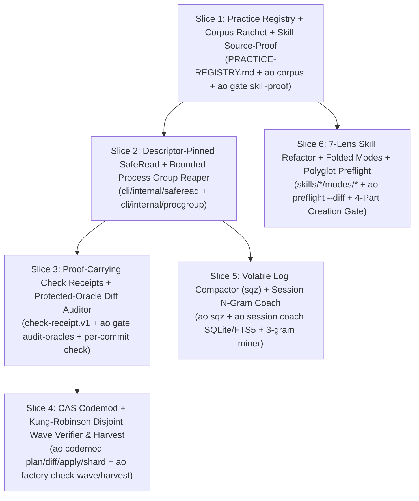

# Volume 6: Actionable AgentOps Upgrade Specification & Implementation Roadmap

> **Scope:** Concrete integration blueprint mapping Volumes 1–5 directly into **AgentOps (`~/dev/agentops/`)** across `PRACTICE-REGISTRY.md`, `docs/contracts/`, `cli/cmd/ao/`, `skills/`, and `docs/patterns/`.

---

## 1. Ten Candidate `PRACTICE-REGISTRY.md` Slugs

To maintain `scripts/validate-practice-citations.sh` integrity in `~/dev/agentops`, add these 10 production-proven practice slugs to `PRACTICE-REGISTRY.md`:

| Proposed Slug | Lineage & Canonical Source | AgentOps Mechanical Consumer |
| --- | --- | --- |
| **`three-locus-capability-broker`** | Capability-Based Security (Levy 1984); OS Process/Namespace Sandboxing (`bwrap` / Seatbelt) | `docs/ARCHITECTURE.md`, `cli/internal/sandbox/`, host extension adapters |
| **`proof-carrying-check-receipts`** | Proof-Carrying Code (Necula, POPL 1997) | `docs/contracts/check-receipt.v1.md`, `ao gate verify-receipt`, `skills/validate/SKILL.md` |
| **`kung-robinson-wave-serializability`** | Optimistic Concurrency Control (Kung & Robinson, ACM TODS 1981); Google Rosie (CACM 2016) | `ao codemod shard`, `ao factory check-wave`, `docs/software-factory.md` |
| **`tricorder-fingerprint-ratchet`** | Google Tricorder Static Analysis Platform (Sadowski et al., CACM 2018) | `ao preflight --diff`, `ao validate`, `.baseline-fingerprints.json` |
| **`systems-data-layout-sys01-05`** | Data-Oriented Design (Acton 2014); SIMD Automaton Filtering (`Aho-Corasick` / `memchr`) | `ao coach`, `ao graph`, `skills/architecture/SKILL.md`, `skills/review/SKILL.md` |
| **`volatile-log-template-compaction`** | Drain Log Template Miner (He et al., ICWS 2017) | `cli/internal/sqz/`, `ao session compact-logs`, `hooks/` |
| **`two-horizon-walking-skeleton`** | Walking Skeleton (Cockburn 2004); *Programming as Theory Building* (Naur 1985); *Tidy First?* (Beck 2023) | `skills/plan/SKILL.md`, `skills/implement/SKILL.md`, `ao gate packet-shape` |
| **`cross-plane-evidence-invariants`** | MacroBase / BubbleUp Cohort Explanation (Bailis et al., SIGMOD 2017) | `docs/patterns/cross-plane-observability.md`, telemetry output-contract validators |
| **`descriptor-pinned-safe-read`** | Capability-Relative Filesystem Traversal (`openat2` / `O_NOFOLLOW`, Linux Kernel / `rustix`) | `cli/internal/saferead/`, `ao gate`, `ao lint` |
| **`cold-read-state-card`** | Generation Effect & Desirable Difficulties (Bjork 1994) | `skills/reverse-engineer/SKILL.md`, `skills/research/SKILL.md` |

---

## 2. New Public Machine Contracts (`docs/contracts/`)

### 2.1 `check-receipt.v1.json` (Proof-Carrying Check Execution Receipt)
Complements `subject-manifest.v1` and `verdict.v2` by proving that required checks ran inside an isolated sandbox on the exact candidate tree without weakening protected test oracles:

```json
{
  "$schema": "https://json-schema.org/draft/2020-12/schema",
  "schema_version": "check-receipt.v1",
  "receipt_id": "rcpt_01j9z8...",
  "repo_root": "/abs/canonical/path/to/repo",
  "base_sha": "a1b2c3d4...",
  "head_sha": "e5f60718...",
  "tree_sha": "99887766...",
  "contract_digest": "sha256:4f3c...",
  "subject_Clean_before": true,
  "subject_clean_after": true,
  "protected_oracles_preserved": true,
  "per_commit_oracle_audit": "passed",
  "required_checks": ["cargo test --locked", "ao gate"],
  "checks": [
    {
      "id": "cargo test --locked",
      "command": "cargo test --locked",
      "status": "passed",
      "exit_code": 0,
      "complete": true,
      "duration_ms": 1420,
      "output_sha256": "sha256:8a1b..."
    }
  ],
  "overall_status": "passed"
}
```

### 2.2 `corpus-entry.v1.md` (Code-Anchored Institutional Knowledge Frontmatter)
Upgrades `.agents/` memory from chronological notes into symbol-anchored, automatically freshness-checked rules:

```yaml
---
schema: corpus-entry.v1
category: decisions | domains | topics
slug: systems-data-layout-jsonl-and-single-pass-io
title: "Systems Data-Layout Contract (SYS-01..05)"
paths:
  - "cli/internal/coach/**"
anchors:
  - "cli/internal/coach/types.go:EventRecord"
  - "cli/internal/coach/parser.go:SaveShard"
invalidation: "Revisit if shard storage migrates from sparse JSONL to SQLite WAL."
---
## Rule & Action
...
## Evidence
...
## Counterexample & Limits
...
```

---

## 3. Six-Slice Dependency-Ordered Upgrade Roadmap for `~/dev/agentops`



### Slice 1 — Practice Registry, Code-Anchored Corpus (`ao corpus`) & Adversarial Skill Proof
- **Write Scope:** `PRACTICE-REGISTRY.md`, `cli/cmd/ao/corpus.go`, `cli/internal/corpus/`, `docs/contracts/corpus-entry.v1.md`
- **Acceptance (Given/When/Then + Negative Invariant):**
  - **Given** a `.agents/corpus/{domains,topics,decisions}/*.md` file declaring `paths[]` and `anchors[]` (`path:symbol`),
  - **When** `ao corpus verify --json` runs,
  - **Then** it verifies every anchored file and symbol exists at `HEAD` (exit `0` when verified, exit `3` with `STALE (N)` when an anchor was renamed/deleted) and verifies every `SKILL.md` CLI citation against `ao capabilities --json` **without** mutating any repository file or accepting a corpus page missing `Rule`, `Evidence`, `Counterexample`, or `Invalidation` (exit `4`).
- **Verify Command:** `go test ./cli/... && ./scripts/validate-practice-citations.sh`

### Slice 2 — Descriptor-Pinned `saferead` & Process-Group Subprocess Reaper
- **Write Scope:** `cli/internal/saferead/`, `cli/internal/procgroup/`
- **Acceptance:**
  - **Given** an untrusted file path or external check command executed by `ao`,
  - **When** opened via `saferead.ReadRegularBounded` or executed via `procgroup.RunBounded`,
  - **Then** symlinks, FIFOs, sibling-prefix escapes (`/root-evil`), mid-read file swaps, shell executables, and leaked grandchild processes holding `stdout` open are deterministically rejected (`exit 4`) **without** hanging or silently truncating output (`OutputLimitExceeded` on overflow).
- **Verify Command:** `go test -v ./cli/internal/saferead/... ./cli/internal/procgroup/...`

### Slice 3 — Proof-Carrying Check Receipts (`check-receipt.v1`) & Per-Commit Oracle Gate
- **Write Scope:** `docs/contracts/check-receipt.v1.md`, `schemas/check-receipt.v1.schema.json`, `cli/internal/gate/oracle.go`, `cli/internal/gate/receipt.go`
- **Acceptance:**
  - **Given** a candidate branch `base_ref..head_ref` and declared `write_scope[]` + `check_commands[]`,
  - **When** `ao gate run-checks` and `ao gate audit-oracles` run,
  - **Then** `ao` audits **every individual commit** in `base_ref..head_ref` for protected-oracle edits, net assertion drops, new skips/suppressions, and out-of-scope writes, executes checks in a sandboxed process group, and emits a SHA-256 `contract_digest`-bound `check-receipt.v1` **without** trusting prose claims or allowing an intermediate assertion deletion restored in a later commit (`exit 4`).
- **Verify Command:** `go test -v ./cli/internal/gate/...`

### Slice 4 — CAS Structural Codemods, Rosie Shards & Kung-Robinson Wave Verifier
- **Write Scope:** `cli/cmd/ao/codemod.go`, `cli/internal/codemod/`, `docs/software-factory.md`
- **Acceptance:**
  - **Given** a structural rewrite or multi-slice wave packet,
  - **When** `ao codemod plan|diff|apply|shard` or `ao gate check-wave` runs,
  - **Then** it enforces Protected-Oracle Deny Policy, verifies symbol-collision absence and post-image idempotency, checks `preimage_sha256` across all files before atomic staging, and verifies pairwise disjoint `write_scope[]` + Kung-Robinson read/write-set serializability ($\text{ReadSet}(S_i) \cap \text{WriteSet}(S_j) = \emptyset$) **without** spawning workers when any scope overlaps (`exit 4`).
- **Verify Command:** `go test -v ./cli/internal/codemod/...`

### Slice 5 — Volatile Log-Template Compactor (`sqz`) & `SYS-01..05` Session Coach
- **Write Scope:** `cli/internal/sqz/`, `cli/cmd/ao/session_coach.go`, `docs/patterns/log-template-compaction.md`
- **Acceptance:**
  - **Given** multi-megabyte session JSONL transcripts or noisy build/test logs,
  - **When** `ao session coach` or the `sqz` filter runs,
  - **Then** it redacts secrets first, collapses `>= 3` volatile progress/test-pass templates and `>= 10` repeated tail blocks while preserving SHAs/UUIDs/diffs/errors, indexes JSONL via raw-slice pre-filtering (`SYS-02`) + single-pass fold (`SYS-03`) + atomic temp+rename with file & parent-dir `fsync` (`SYS-04`) + $O(1)$ `stat` `(dev, ino, size, nlink==1)` resume (`SYS-05`), and mines 3-step domain tool n-grams **without** corrupting valid JSON outputs.
- **Verify Command:** `go test -v ./cli/internal/sqz/...`

### Slice 6 — Folded Skill Modes (`modes/*/mode.md`), 7 Design Lenses & 4-Part Creation Gate
- **Write Scope:** `skills/plan/`, `skills/implement/`, `skills/review/`, `skills/research/`, `skills/ergonomics/`, `docs/SKILL-API.md`
- **Acceptance:**
  - **Given** canonical skills in `skills/`,
  - **When** refactored to root `SKILL.md <= 120` lines + on-demand `modes/<mode>/mode.md` and enriched with the **7 Architectural Lenses**, **4 Adversarial Review Lenses (with 3-Pass Convergence)**, **4-Part Creation Gate**, **Two-Horizon Walking Skeleton**, and **Cold-Read Variable State Card**,
  - **Then** root skill token footprint drops by `> 60%` while `ao skills graph` and `scripts/validate-practice-citations.sh` pass with zero broken links or unverified commands (`exit 0`).
- **Verify Command:** `make validate`
