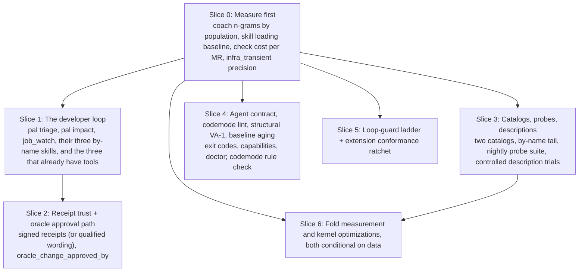

# Volume 7: Harness Design Enhancement — Skills, Rust CLI and pi Extensions for Two Engineering Populations

> **Scope:** The harness is the unit of design: the skill catalog (Locus 1), the Rust `pal` CLI (Locus 2) and the TypeScript pi host extensions (Locus 3), built by one platform team and used by that team and by the autonomy developers it tools. This volume starts from the shape Volumes 1 to 6 describe, keeps what is already right, and proposes concrete additions and changes, ordered into a roadmap. Lessons from AgentOps, a sibling harness that was measured through 2026, are applied where they bear. Volume 6 keeps its mechanism detail; this volume supersedes its ordering and its target.
>
> **How to read it:** Section 0 is the system and its users. Section 1 is what to keep. Section 2 is the enhancements by component, each with the friction it answers, alternatives, risk and strength. Section 3 is the lessons table. Section 4 is the claims ledger. Section 5 is the roadmap. Section 7 is what the author could not know from outside.

---

## 0. The harness and who it serves

### 0.1 Three components, one loop

| Component | What it is today (Vols 1-6) | What it is for |
| --- | --- | --- |
| **Skills** (Locus 1) | 45 core skills with 90+ folded modes, 8 robotics skills, 14 package-bundled skills (6 SDK, 5 governance-core, 3 other); a registry with single-home placement; a code-anchored corpus; 7 design lenses, 4 review lenses, 4 spike lenses | Judgment and procedure the model carries into a session: how to plan, review, hand off, diagnose |
| **Rust CLI `pal`** (Locus 2) | `#![forbid(unsafe_code)]` kernel: diff validator with fingerprint ratchet and merge-tree probe, CAS codemods and wave shards, graph ontology and impact, session coach, readability/layer/secret lint, descriptor-pinned reads, bounded process groups; the Python workbench carries `mr_validate` and the `BA101..BA602` rules | Deterministic work that should cost zero model tokens: probes, joins, rewrites, checks |
| **pi extensions** (Locus 3) | Software factory (managed checks, branded receipts, oracle gate, deterministic plans, precomputed waves, candidate integration, `sqz`), GitLab workbench (snapshot, fault tree, pipeline watch), cluster broker (diagnose, Loki/Tempo join, cohort diff, output contracts), robotics workbench, governance broker (egress scrub, loop guard, classifier, `bwrap`), QuickJS `codemode` | Everything that needs credentials, network, subagents or a hook on the session |

The loop they serve is the same for every user: change, check, receipt, review where a mistake is costly, hand off. The components differ in who pays for a step: a skill costs model tokens every time, a tool costs them once when it is built.

### 0.2 Two populations, both on pi

| Population | Stack | Working style | Relationship to the harness | What they reach for |
| --- | --- | --- | --- | --- |
| **Platform team** (authors) | Ansible, CI/CD, Helm, Terraform, Kubernetes on a hyperconverged virtualization platform, container builds | XP mobbing: one driver, shared screen, frequent rotation | Build the skills, the CLI and the extensions; use pi for their own infrastructure work | The whole catalog. They read folded modes, tolerate the governance layer because they wrote it, and notice when a skill is wrong. |
| **Autonomy developers** (consumers) | Python test scripts and orchestration code, C++17 real-time apps, batch jobs on the cluster, CI/CD, container builds, CUE configuration | Individual engineers under delivery pressure; a REPL-and-rerun loop around a batch campaign | Use the pi coding harness, skills and extensions the platform team ships for them, in their own sessions and through CI | Whatever answers fastest in their own words: a by-name skill, a tool that returns one decision pack, a CI note. They do not browse a catalog or open a mode file, and the first thing they abandon is a multi-turn model loop a tool could have replaced. |

Both are software engineers and the core loop is the same. The difference is adoption: the authors will use what is listed; the consumers use what is named and what answers in one call. That decides two things in this volume. The consumer surface is a short set of by-name skills, each backed by a tool, and the biggest wins for them are zero-token: triage, impact-to-test-slice, and a batch-job watch that lets the agent sleep while the cluster runs.

---

## 1. What is already right

Keep these as designed. They are the spine the enhancements hang on.

1. **Proof-carrying receipts with a recomputed digest, the pre/post subject bracket, and the per-commit protected-oracle audit** (Vol 4 §1.1 to §1.5). The best anti-reward-hacking mechanism in the packet, and it is built.
2. **The zero-token read path** (Vol 3 §1.2, Vol 4 §2): one call binds a six-part snapshot, walks the fault tree, classifies infra-transient against step boundaries, and re-fetches to catch a moved subject.
3. **Fail-closed engineering throughout**: `Verdict` has no `Default`, unknown status parses to `Open` (Vol 2 §1, §2), cohort ranking is suppressed below the cardinality floor (Vol 2 §5, Vol 4 §3.1), egress aborts before it throws (Vol 3 §3.1).
4. **The loop guard's call-plus-result fingerprint** (Vol 3 §3.2), which does not punish legitimate polling.
5. **Volume 2's gap matrix**, which separates what is live from what is a target. The rest of the packet should follow it; Section 4 does.

---

## 2. Enhancements by component

Each item follows one shape: the friction it answers, the proposal, alternatives including "leave it", risk, strength. Strength is `recommend` when the friction is located and the first step is reversible, `consider` when the pain is real but the shape should be probed first, and `note` when it is a signal without demonstrated pain.

### 2.1 Skills (Locus 1)

**E1. Two catalogs by audience, the rest by name only.**
- *Friction:* 67 skills in one registry (Vol 5). In the AgentOps 3.11 plugin eval, quiet routing failed outright for 5 of 28 skills and was unreliable for 7 more, the misses loaded no skill at all rather than a rival, and by-name skills were the one reliable path (22 of 24 when named). Whether listing size itself drives the misses is a hypothesis the eval could not confirm. Fifteen infrastructure skills (Vol 5 §2.6) are the platform team's playbooks, as are the five governance-core skills in §3.2 (extension security, skill dependencies, CA trust, URL migration) and the onboarding-lab skill; the eight robotics skills (§3.1) and the six SDK-workbench skills (§3.2) are the developers'. Neither population needs the other's skills listed for quiet routing.
- *Proposed:* a platform catalog of roughly 20 quiet-routed skills, a developer catalog of under 10 (E2), and everything else by-name only (description says "use only when named"; check pi's listing mechanics first, since an unlisted skill may be reachable only by slash command). Measure loading on blind requests before and after.
- *Alternatives:* merge roots further so the listing shrinks (one AgentOps dose test could not separate entry count from characters, and removing nine entries did not restore loading, so a smaller listing alone is not the fix). Leave it: one registry serves both populations today, and the misses land hardest on the consumers because they do not know what they are missing.
- *Risk:* by-name skills stop being discovered by new team members. The onboarding skill names them.
- *Strength:* recommend.

**E2. A developer loop set: eight by-name skills, each backed by a tool.**
- *Friction:* the robotics and SDK skills (Vol 5 §3) are organised by subject (C++ concurrency, CUE overlays, packaging, ontology migration). A developer under pressure does not think in subjects; they think in the step they are stuck on. Every skill that has no tool behind it makes the model recompose the same tool calls each time, which is the loop they abandon first.
- *Proposed:* a developer catalog of at most eight skills named for the step, each with a one-paragraph action-first body and one tool call behind it:

| Skill (by name) | Backed by | Step it answers |
| --- | --- | --- |
| `triage` | `pal triage` (E9) | "this job failed, whose is it, what do I run" |
| `test-slice` | `pal impact` (E10) | "I changed these files, which tests and CI jobs do I need before I submit" |
| `job-watch` | batch-job watch (E16) | "submit this campaign, wake me when it ends, then triage" |
| `container-fix` | `BA305` (Dockerfile `COPY` import closure), `BA602` (CI image hygiene), `repo-lint.py --fix` for the lint-fixable part; build failures route to `triage` | "the runtime import closure or the CI image definition broke" |
| `overlay-check` | `BA201..204`, `BA401` | "my CUE change: parity, port names, job-name budget" |
| `cpp-review` | `BA101..108`, headless GDB batch backtrace | "review this C++ change for init, locks, lifecycle" |
| `py-test` | the `pytest` slice from `pal impact` (E10) plus the `software-delivery/testing` mode, with `S-PY1..6` as the style check on the result | "write or repair the Python test for this behavior" |
| `handoff` | the four-line handoff template | "I am stopping; leave the state for whoever is next" |

  The subject skills in Vol 5 §3 stay as references these eight point into when the tool returns `unknown` or the developer asks why.
- *Alternatives:* keep the subject organisation and teach it (the consumers will not learn it). Leave it.
- *Risk:* eight is a guess; the right number is what the coach n-grams (slice 0) show the developers actually do. Three have tools behind them today (`overlay-check`, `cpp-review`, `handoff`); `triage`, `test-slice` and `job-watch` arrive with E9, E10 and E16 in slice 1; `container-fix` and `py-test` follow once their tools exist. Add on evidence.
- *Strength:* recommend.

**E3. Every skill carries a probe case, run in CI, with all-attempt denominators.**
- *Friction:* the harness has a `headless-validation` mode (Vol 5 §2.5) but nothing says it runs continuously or per skill. AgentOps found, only when a measured eval ran, that 5 of 28 skills never routed on blind requests and 7 more routed only sometimes.
- *Proposed:* each skill ships a case file: one blind request that should load it, one that should not, and one criterion a grader can check in the transcript. A nightly job runs the suite against the current model, counts every attempt (failed, timed out, crashed and all), and posts load rate and criteria met per skill. A description change is trialed against a same-day control with the rule and the spend cap written first; AgentOps' comparable trials cost about two dollars per 13-run arm.
- *Alternatives:* trust reviews of the text (in AgentOps' maintainers' notes, not in the repo, a re-score found fresh readers kept finding new defects at about a third of the rate they closed, so text review alone converged slowly). Leave it.
- *Risk:* model spend. Bound it per night and report it beside the results.
- *Strength:* recommend.

**E4. A graduation ritual: from n-gram to tool to shorter skill.**
- *Friction:* Vol 3 §1.2 stage 4 mines 3-step tool sequences from sessions, but the packet does not say who acts on them or how a skill shrinks when a tool replaces its procedure. Without a ritual, the n-gram report is a dashboard nobody branches on.
- *Proposed:* once a sprint, the top three 3-grams with error counts go through a one-page template: the sequence, the proposed composite tool, its consumer, the skill text that retires when it ships, and the countermetric (did the 3-gram count fall). A tool is built only when the template is complete; a skill paragraph is deleted when the tool lands. Record how many 3-grams became tools; that is the number Vol 3 is missing (Section 4).
- *Alternatives:* leave the report to be read when someone remembers.
- *Strength:* recommend.

**E5. Measure the folded structure instead of asserting it.**
- *Friction:* the skills are already folded (90+ mode files) and nothing says whether the right mode is opened when a task needs it. Vol 6 slice 6 exports the shape to AgentOps with "root under 120 lines, token footprint down 60%" as acceptance; neither is an outcome. AgentOps' own restructure (three skills added, 28 changed) measured level on content and worse on loading, which is what an unmeasured restructure looks like after the fact.
- *Proposed:* for the three skills with the most modes, run E3's suite in two arms, folded as today and flattened into one file, alternating launch order; in the folded arm also record how often the needed mode file was opened. Keep the fold where loading and criteria are not worse; report footprint, do not target it.
- *Alternatives:* keep folding by taste. Leave it.
- *Strength:* recommend, conditional on slice 3's data (slice 6).

**E6. Make `VA-1` structural: cite a receipt, do not police adjectives.**
- *Friction:* Vol 1 §2.4 blocks "proven / validated / confirmed / works" when no receipt backs them. The rule catches true sentences and misses paraphrases; every fresh reviewer can construct the next edge case. AgentOps spent six review rounds on one such gate before deleting it (recorded in the maintainers' notes).
- *Proposed:* every spike or issue in a "validated" or "ready" state must cite at least one receipt id, CI job URL or validation rung, and the deterministic check verifies each citation resolves. Whether the receipt covers the claim is the reviewer's job.
- *Alternatives:* keep the word list as `WARN`. Leave it.
- *Strength:* recommend.

**E7. Generate Volume 5 from the registry.**
- *Friction:* 300 hand-written lines that drift the day a mode is renamed; `registry-check` already holds the data (Vol 5 §1.1).
- *Proposed:* `pal registry render --markdown`; the encyclopedia becomes a build artifact and only the placement gate and resolution order stay hand-written.
- *Strength:* recommend; reversible at every step.

**E8. Count corpus retrievals that change an outcome.**
- *Friction:* the code-anchored corpus with `file:symbol` anchors and staleness exit codes (Vol 6 §2.2) is good engineering. AgentOps built a different corpus (lessons mined from review escapes) and recorded that its mechanism was proven and its compounding unproven, not disproven: catches at review were plentiful, learning from catches measured null, and the corpus starved because escapes were rare at frontier quality (ADR-0004, ADR-0011).
- *Proposed:* keep the anchor check; add one counter for rules retrieved that changed an outcome (a blocked diff, a corrected plan). Review quarterly; archive rules with zero hits.
- *Strength:* consider.

### 2.2 Rust CLI `pal` (Locus 2)

**E9. `pal triage`: one entry point for a failed job, inside pi and in CI.**
- *Friction:* the pieces are spread across three loci: `mr_validate` and the `BA101..BA602` rules in the Python workbench (Vol 4 §4), `validate`, `graph` and `coach` in the kernel (Vol 2 §4), the batch-pod diagnoser `robotics_k8s_diagnose` in the credentialed cluster broker (Vol 5 #48; it queries the observability planes over the Kubernetes `services/proxy` with no port-forward), and the four-owner classification (`Dev Code | Dev Config | Simulation Framework | IT Platform`) only as a model-run skill (`batch-ci-diagnostics`, Vol 5 #48). A developer needs one command and one answer.
- *Proposed:* `triage <mr | job | log>` with `--json` and a 2 KB decision pack, in two layers. Layer one is shared and needs no network: `mr_validate`, the BA rules, and a new deterministic owner rule table mapping signals (which plane failed, which rule fired, whether the failure is in the job's own script or in setup) to an owner or `unknown`; it runs in the sandboxed kernel and Python workbench inside pi and as a CI job template that posts the pack as an MR note. Layer two is pi-only, because it lives in the cluster broker extension and needs its credentials: `robotics_k8s_diagnose` over the failed pod, joined into the same pack. In CI the pack carries layer one and a link to the pod diagnosis. The `triage` skill is a one-paragraph by-name entry to the tool. The model-run `batch-ci-diagnostics` skill handles `unknown`, and its answers feed rows into the table.
- *Alternatives:* the model-run skill alone (today: the model recomposes the same sequence of tool calls every time). CI note only (misses the engineer already in a session).
- *Risk:* the table is wrong often enough to lose trust, or says `unknown` so often nobody reads it. Log every classification with the later human verdict; publish precision and the `unknown` rate monthly.
- *Strength:* recommend.

**E10. `pal impact`: changed files to the exact test slice and CI jobs.**
- *Friction:* the slicers exist but are three tools in two languages with no single entry: `robotics_preflight(mode="impact")` and `robotics_ctest_slice` in the Python workbench (Vol 5 #53), the dossier's plane 6 `compute_impact` (CMake targets, `ctest -R` regex, `pytest` files, CI jobs; Vol 4 §4.3), `check-slice.py` for Ansible roles and playbooks to CI stages and tags (Vol 5 #17), and the kernel's bounded `graph_impact` with its explicit frontiers (Vol 2 §4.1). The developers' expensive step is submitting a batch campaign to find out an hour later that a unit test would have caught it; the platform team's is pushing a role change to find out in CI which stage it touched.
- *Proposed:* one composite verb, `pal impact --changed <paths | --diff base..head>`, that runs the existing slicers under the kernel's bounded process group (`process.rs`) and merges their output into one pack: `ctest -R` regex and `pytest` paths from the robotics slicers, Ansible tags and CI stages from `check-slice.py`, CI jobs and unmapped-path frontiers from `graph_impact`. Nothing is re-implemented; the verb is the join. Wire it three ways: the `test-slice` skill, a pre-submit hook that runs the slice before a batch job is queued, and a CI `rules:changes` generator so diff-scoped pipelines stop being hand-maintained (Vol 1 §3 row 7 names that as the anti-pattern).
- *Alternatives:* run the whole suite every time (the current cost). Leave the three slicers separate and let the model compose them.
- *Risk:* a wrong slice gives false confidence. Mitigation: the pack states its frontier explicitly (`awaiting-remap` for unmapped paths, as `graph_impact` already does) and the nightly full run reports slice misses.
- *Strength:* recommend.

**E11. Decide whether receipts cross a process boundary, and sign them if so.**
- *Friction:* Vol 4 §1.1 verifies the `Symbol` brand and presence in a private in-memory `Map`, so a receipt from another process fails closed. Safe, and a limit: a promotion job that did not mint the receipt cannot consume one. The `check-receipt.v1` JSON (Vol 6 §2.1) would be the carrier, and a file is only as trustworthy as its digest plus whoever could write it.
- *Proposed:* if cross-process trust is wanted, the minting host extension (`check-evidence.ts`, outside the sandbox) signs the canonical receipt with an asymmetric key and the promotion job verifies with the public key and recomputes the contract digest. A symmetric MAC is not enough: any job that can verify could forge. If not wanted, keep in-process and change "unforgeable" to "unforgeable within the minting process".
- *Risk:* key custody in the regulated profile (§7).
- *Strength:* recommend one of the two.

**E12. An explicit, visible approval path for protected-oracle edits.**
- *Friction:* Vol 4 §1.3 blocks any "unapproved" edit to `tests/`, CI templates and checker scripts but never says what approval is or where it lives. If the path does not exist, agents stop touching tests and narrow scope instead (`RH-4..9`); if it exists but is not in the receipt, a reviewer cannot see that an oracle changed under approval.
- *Proposed:* a human-held token on the MR or bead (`oracle_change_approved_by`) that the audit requires for protected paths and records in the receipt with the assertion delta. The audit keeps reporting drops and skips; approval acknowledges, it does not silence.
- *Alternatives:* allow test additions, block only deletions and skips. Leave it.
- *Strength:* recommend.

**E13. Age the fingerprint baseline.**
- *Friction:* a 16-hex fingerprint baseline (Vol 4 §4.1) grows forever; legacy findings become permanent.
- *Proposed:* each entry carries the admitting commit and expires after N touches of its file; expired entries warn for one release, then block.
- *Strength:* consider.

**E14. One agent-facing contract across every verb.**
- *Friction:* Vol 1 lens 7 asks for `--doctor [--json]`, `--fix`, `--undo` and stdout/stderr separation, `capabilities --json` already exists (Vol 1 §2.3, Vol 5 #12), and the verbs each report exit codes their own way; the packet never states one contract. An agent caller learns a CLI from `--help` and from exit codes; inconsistency there is paid on every call.
- *Proposed:* one documented contract: `--json` on every verb; exit `0` pass, `2` usage, `3` stale or not-proven, `4` block, consistent across verbs (new; the kernel already uses `3` for stale anchors and `4` for blocks in places, Vol 6 slice 1); the existing `pal capabilities --json` extended to list exit codes and flags per verb so it is the one source skills and the E3 suite check against; `pal doctor --json` with named checks for toolchain presence, sandbox availability, credential presence (never values), cache state and baseline age, each with a fix hint that names a live verb. Skills cite verbs by name and the E3 suite fails when a cited verb or flag is not in `capabilities`.
- *Alternatives:* leave each verb's conventions as they are.
- *Strength:* recommend.

**E15. Defer the Gauntlet optimizations.**
- *Friction:* Vol 2 §6 lists CSR adjacency and `FixedBitSet` masks as targets and §3 lists `as_chunks` elision as a pattern; none is tied to a measured hot path. The packet's own Opportunity Matrix (score at or above 2.0 with an isomorphism proof) applies.
- *Proposed:* no work until slice 0 shows graph or validate queries in the top three friction 3-grams or a p95 above a stated budget.
- *Strength:* recommend as a deferral.

**Note.** The descriptor-pinned reader and the process-group reaper (Vol 2 §2.2, §2.3) are correct and complete. The one durability addition the gap matrix lists, parent-directory `fsync` after `rename()`, belongs to `atomic_write_private` (SYS-04).

### 2.3 pi extensions (Locus 3)

**E16. Batch-job watch: the pipeline-watch pattern for the cluster.**
- *Friction:* Vol 4 §2 already gives GitLab pipelines a zero-token background watch that ends the turn and wakes the model once on a terminal state. The developers' long waits are batch jobs on the cluster, not pipelines, and today the agent either polls them (tokens) or the developer context-switches away and loses the session.
- *Proposed:* `job_watch` in the cluster broker with the same shape as `pipeline-watch.ts`: keyed by namespace and job, `AbortController` tied to session shutdown, poll interval clamped, `terminate: true` on start, one `sendMessage(..., { triggerTurn: true })` on completion or first failed index, and the wake handler calls `pal triage job <id>` so the developer returns to an owner and a reproduction, not a log. The GitLab step-boundary classifier (Vol 4 §2) does not apply to cluster jobs, so `job_watch` needs its own small rule: a pod that never started (pending past a bound, evicted, node pressure, image pull failure) is a scheduling transient and does not wake anyone on `fail_fast`; a container that started and exited non-zero is a real failure and does.
- *Alternatives:* a polling loop inside `codemode` (its own ten-second rule forbids it, Vol 3 §2). Leave it.
- *Risk:* watches that outlive their session. The abort-on-shutdown already handles it; add a cap on concurrent watches per session.
- *Strength:* recommend.

**E17. Map the loop guard to a three-rung ladder.**
- *Friction:* Vol 3 §3.2 nudges at streak 3, blocks at 4, hard-stops after 5 ignored blocks; every rung is the same context again. AgentOps' charter (ADR-0017) settled on direct repair, then at most one bounded fresh helper for that incident, then a human; an unhelpful helper answer ends the attempt.
- *Proposed:* on the first hard block whose cause the guard cannot name (a known failure gets direct repair, as the charter says), spawn one fresh context with the last 16 events and the block reason, asking one question. If the next call does not change, end the turn with a written handoff. Never a second helper.
- *Strength:* recommend.

**E18. Extension growth gated by the conformance suite only.**
- *Friction:* extensions are where credentials and network live, and the count grows with every broker. `extension-conformance` (Vol 5 §2.5) exists as a mode, not a gate.
- *Proposed:* registration requires the conformance tests green in CI, including the abort-before-throw ordering test from Vol 3 §3.1; the count of network-touching extensions cannot rise without a recorded decision.
- *Strength:* recommend.

**E19. Lint `codemode` scripts against their own production rules.**
- *Friction:* Vol 3 §2 lists three rules learned from incidents (no long-running subagents inside `codemode`, no `JSON.parse` on spilled reads over 50 KiB, keep scripts under about ten seconds) and leaves them as prose.
- *Proposed:* a static check on the script text before the VM runs it: flags `tools.explore`, `tools.implement`, `tools.validate`, `tools.council` and `pipeline_watch` calls; flags `JSON.parse(await tools.read(` ; warns when the declared `timeout_ms` is above the budget. Refuse with the rule name.
- *Strength:* recommend; small and reversible.

**Note.** `sqz` (Vol 4 §1.7) is well designed: secrets first, valid JSON untouched, errors and diffs preserved. State the 64 KiB scan window as a bound and report when it is hit. The zero-token pipeline watch with the section-scoped `infra_transient` classifier is the right shape for a regulated GitLab; record its precision against later human reruns, which decides whether `NOT_PROVEN` on a transient may auto-retry once.

### 2.4 Cross-cutting

**Where judgment is worth its cost.** The factory runs sandboxed checks on every wave and mints a receipt; that is cheap and stays universal. A model review of the diff is not cheap and the packet does not say when it is owed. AgentOps moved to conditional review (ADR-0017) because review cost was exceeding the cost of the work and review-plus-revalidation loops did not converge; the ADR claims no measured quality effect, and the maintainers' notes record a refute rate near 3% on routine diffs from an internal meter, outside the repository. Rule: receipt and CI are the gate for an ordinary change. One fresh author-distinct read is owed only when the caller asks, when the change cannot be cheaply undone after it lands (promotion into the regulated environment, a protected-oracle edit, deleting a check, a credential or egress change), or when no deterministic check covers the behavior. One round, one question, no re-running checks; a repair is confirmed by a check. `PL-5`'s fresh judge is that costly-door reviewer, not an every-MR reviewer.

**Two handoff shapes.** The mob already has the four-line handoff (Vol 5 #3). The individual developer needs the other direction: every `triage`, `impact` and `job_watch` pack opens with a three-line state card (what was run, on which snapshot, what is still unknown) so a developer returning after an hour can read the state cold without re-deriving it. That is the cold-read card from Vol 5 #67, turned from a teaching device into an output format.

---

## 3. AgentOps lessons applied

Each row names a lesson AgentOps paid for, where the harness is exposed to the same failure, and the change.

| Lesson (what happened in AgentOps) | Where the harness is exposed | Change |
| --- | --- | --- |
| Wording gates never converge; reviewers construct the next edge case forever (six rounds on one public-copy gate, in the maintainers' notes). Fixed by deleting word rules and checking facts. | `VA-1`, `SC-1..4`, the `noslop` check | Check for the receipt or the structure; leave meaning to the reviewer (E6). |
| Quiet routing failed for 5 of 28 skills and was unreliable for 7; by-name loaded 22 of 24 when named; cutting nine entries did not restore loading, and whether listing size drives the misses is unconfirmed. | 67 skills in one listing | Two catalogs and a by-name tail; a developer set of eight; do not sell a listing cut as a loading fix (E1, E2). |
| Content measured level while loading measured worse after a restructure that added three skills and changed 28; none of the four causes tested explained it. | The existing fold; the Vol 6 60% target | Measure the folded structure in two arms (E5). |
| Description changes moved loading only in a same-day controlled trial with the rule fixed first; 6 of 11 candidates were null. | Trigger phrases across Vol 5 | Probe cases and controlled description trials (E3). |
| The routing failures above (5 never, 7 sometimes, of 28) were found only when a measured eval ran. | No continuous per-skill measurement | Nightly probe suite with all-attempt denominators (E3). |
| The corpus mechanism was proven and compounding unproven, not disproven; an escape-fed corpus starved because escapes were rare. | `.agents/corpus/`, `pal corpus verify` | Keep freshness; count retrievals that changed an outcome (E8). |
| A fail-open helper (`\|\| true`, a dead subprocess) reads as "no findings". | `sqz` spill, `codemode` cancellations, watch abort on mode change | Every helper death is `not_proven`; make it a conformance test (E18). |
| A gate that validates the worktree, not the commit, misses what landed. | Already handled: per-commit oracle audit | Keep. |
| One unhelpful helper answer ends the attempt; retries past that burn budget and trust. | Loop guard's five strikes | Three-rung ladder (E17). |
| Thresholds invented before data contradicted the measurement they were meant to use. | 25% throttling, cohort floor 3, `max_pipelines = 20`, `L <= 1..2` | Slice 0 collects two weeks of data before a default becomes a rule. |
| Every eval and metric needs an all-attempt denominator and a countermetric. | `136x`, `427 sessions`, `>10 GiB/s` | Claims ledger (Section 4); countermetric on every slice (Section 5). |
| Process artifacts earn no credit; name consumer, gate, defect, retirement first. | Vol 5 encyclopedia, Vol 6's slugs and contracts, the n-gram report | Generate Vol 5 (E7); the graduation ritual gives the n-gram report a consumer (E4); park the slugs (Section 5). |
| Deterministic checks prove facts; a fresh context judges meaning; the author's context cannot issue its own PASS. | `software-review/acceptance`, `PL-5` | Aligned; adopt the costly-door rule (§2.4). |
| A second model family caught public-copy errors the first family passed (maintainers' notes); it earns its keep on outward-facing text and security boundaries. | Regulated promotion, egress policy, anything published to the developers | A second family on exactly those; not on routine diffs. |

---

## 4. Claims ledger

Status: **Measured** means the packet or its source gives a reproducible method and a denominator; **Claimed** means a number is stated without them; **Library** means the figure belongs to a dependency's published benchmark; **Design constant** means a bound the code enforces, neither measured nor claimed until its hit rate is observed; **Target** means the packet presents it as acceptance rather than observation. The last column says what would move each row to Measured.

| Claim | Where | Status | To make it Measured |
| --- | --- | --- | --- |
| Two-tier equivalence join: `98,318 ms -> 720 ms` (`136x`) | Vol 3 §1.2, Vol 5 §2.6 | Claimed | State repo size, file count, cold vs warm cache, runs per arm, and the median. |
| `427` sessions, `59,725` tool events mined for 3-grams | Vol 3 §1.2 stage 4 | Claimed (as a count) | The missing number is how many 3-grams became tools and what the loop count did afterwards (E4 records it). |
| Aho-Corasick fast path `> 10 GiB/s` | Vol 2 §3 | Library | Measure `pal`'s own scan on its own corpus; report bytes, time, and the share of files that skip the regex pass. |
| `5 ms` reaper poll, `1 s` kill grace | Vol 2 §2.3 | Design constant | Add the observed p99 time-to-reap on a leaked grandchild. |
| 16-event window, periods `1..4`, nudge at 3, block at 4 | Vol 3 §3.2 | Design constant | Report false-nudge rate on legitimate polling over a month. |
| `256` calls, `8` concurrent, `8 MiB` outstanding, `16 MiB` output | Vol 3 §2 | Design constant | Report how often each cap is hit; a cap never hit is set wrong. |
| `infra_transient` only on a runner `failure_reason` or an infra pattern in the five pre-script sections | Vol 4 §2 | Design constant (a rule) | Report precision against later human reruns. |
| Root `SKILL.md` token footprint down `> 60%` | Vol 6 slice 6 | Target | Two-arm eval (E5). A footprint is an input, not an outcome. |
| "Unforgeable" receipts | Vol 4 §1.1 | Claimed (true in-process) | Sign for cross-process trust or qualify the word (E11). |
| Opportunity Matrix score `>= 2.0` | Vol 1 §2.1, Vol 2 §5 | Target (heuristic) | Fine as a heuristic; do not report it as a measurement. |
| Review WIP `L <= 1..2` per pair | Vol 2 §5 | Target (heuristic) | Record merge throughput and open-MR count for a month; set the cap from the data. |

---

## 5. Roadmap

Replaces Volume 6 §3 on ordering and target. Volume 6 keeps the mechanism detail. Every slice carries the 4-Part Creation Gate (consumer, gate, observed defect, retirement) and a countermetric, because the packet's own rule demands it and because that is how a slice gets refused when it should be. Write scopes name harness paths generically; the real ones are behind the wall.

### Slice 0: Measure first (two weeks of data; no default becomes a rule before it)
- **Consumer:** every later slice's acceptance. **Gate:** nothing ships a threshold without it. **Observed defect:** the packet sets targets and thresholds with no baseline: 60% (Vol 6 slice 6), the 2.0 opportunity score (Vol 1 §2.1, Vol 2 §5), 25% throttling and a cohort floor of 3 (Vol 2 §5). **Retirement:** when the reports below exist in the harness's own telemetry.
- **Work:** `coach report` 3-gram mining on all sessions, split by population; skill loads per blind request per catalog; check wall-time and sandbox cost per MR; `infra_transient` classifications with the later human verdict; loop-guard nudges and blocks with whether the next call changed; how often developers wait on a batch job inside a session.
- **Acceptance:** Given two weeks of sessions, when the report runs, then it prints the top ten tool 3-grams per population with counts and error rates, skill load rate per catalog with all-attempt denominators, cost per receipt, the infra-transient confusion matrix, and batch-wait minutes per session, without any threshold being set from a single run.
- **Countermetric:** telemetry under a stated bound; if measuring costs more than 2% of session tokens, the measurement is wrong.

### Slice 1: The developer loop
- **Consumer:** the autonomy developers' pi sessions and their MR pipeline. **Gate:** their change-test-submit-triage loop. **Observed defect:** the loop today is "run the campaign, read a log, ask the platform team"; the platform team is the Brent in the packet's own Theory of Constraints framing, and the model recomposes the same tool calls each time. **Retirement:** when `triage`, `test-slice` and `job-watch` are the default moves in their sessions and the question count to the platform team drops.
- **Work:** E9 `pal triage` (two layers, pi tool and CI template), E10 `pal impact` (composite verb, pre-submit hook, `rules:changes` generator), E16 `job_watch` waking into `triage`, the three by-name skills that front them (`triage`, `test-slice`, `job-watch`) and the three that already have tools (`overlay-check`, `cpp-review`, `handoff`) from E2, each pack with a state card header (§2.4).
- **Acceptance:** Given a developer who changed two C++ files and a Python test, when they run `test-slice`, then the pack names the `ctest -R` regex, the `pytest` paths and the CI jobs within two seconds for the static part, with unmapped paths marked `awaiting-remap`. Given they then submit the campaign under `job-watch`, when the job reaches a terminal state, then the turn wakes once with a `triage` pack naming one owner or `unknown`, the failing check, the smallest reproduction and the receipt id, without a container that exited non-zero ever being classed a scheduling transient and without any tokens spent while the job ran.
- **Countermetric:** triage precision and `unknown` rate monthly; slice misses from the nightly full run; batch-wait minutes per session from slice 0, which should fall.

### Slice 2: Receipt trust and the oracle approval path
- **Consumer:** the regulated promotion gate and the per-commit oracle audit. **Gate:** promotion into the regulated environment. **Observed defect:** a receipt cannot be consumed by any job that did not mint it; the oracle approval path is unnamed and invisible in the receipt. **Retirement:** when every promotion decision cites a verified signed receipt (or a recorded decision keeps receipts in-process) and approvals appear in the weekly merge review.
- **Work:** E11 and E12.
- **Acceptance:** Given a receipt copied to the promotion job with one byte changed, when the gate verifies it, then `not_proven` with the signature or digest mismatch named, without trusting any field it did not recompute or verify. Given a test deletion with a recorded approval, when the audit runs, then it passes and the receipt carries the approver and the assertion delta.
- **Countermetric:** approvals per week against test additions; rising approvals with flat additions means rubber-stamping.

### Slice 3: Catalogs, probes and descriptions
- **Consumer:** the routing layer, the onboarding skill, the nightly job. **Gate:** skill loading on blind requests. **Observed defect:** one registry for two populations; no continuous measurement; AgentOps' finding that 12 of 28 skills routed unreliably or never, found only by a measured eval. **Retirement:** when both catalogs hold a stated loading floor for a month.
- **Work:** E1, E3, E4 (the ritual's first run), E7, E8 (the retrieval counter, read at the ritual).
- **Acceptance:** Given the slice 0 baseline, when the two catalogs and the probe suite ship, then blind-request loading is not worse for any skill and better for at least one per catalog, with all-attempt denominators, and every skill has a case file, without any skill losing by-name invocation.
- **Countermetric:** by-name skills never invoked in a quarter, reported as archive candidates; nightly spend against its cap.

### Slice 4: Agent contract, `codemode` lint, structural `VA-1`, baseline aging
- **Consumer:** every agent call into `pal`; every `codemode` script; every spike or issue marked ready; the fingerprint baseline. **Gate:** skills citing verbs; scripts entering the VM; the spike audit; the preflight ratchet. **Observed defect:** conventions grew one verb at a time; three incident rules live as prose; `VA-1` polices adjectives; baseline entries never expire. **Retirement:** when `capabilities --json` is the source the E3 suite checks skill citations against, the lint has refused its first real script, and the first aged baseline entry has fired.
- **Work:** E14, E19, E6, E13.
- **Acceptance:** Given any verb, when called with `--json`, then stdout is one JSON document and the exit code is one of `0 2 3 4` as documented; given a `codemode` script that wraps `tools.implement`, when submitted, then it is refused with the rule name before the VM starts; given a spike marked ready with no receipt citation, when the audit runs, then it blocks on the missing citation and never on a word.
- **Countermetric:** verbs whose documented exit code disagrees with observed behavior, from the nightly suite; `codemode` scripts refused per week (a rising count means the rules are not reaching authors); spikes blocked for a missing citation that a reviewer then passes anyway.

### Slice 5: Loop-guard ladder and extension conformance ratchet
- **Consumer:** the governance broker and the extension registry. **Gate:** every hard block; every extension load. **Observed defect:** five strikes of the same context; extensions grow without a count. **Retirement:** when the helper rung fires less than once a week.
- **Work:** E17, E18.
- **Acceptance:** Given a repeated blocked call, when the guard arms, then exactly one fresh context is consulted and the turn ends with a written handoff if the next call does not change, without a second helper. Given a new extension whose abort-before-throw test fails, when registration runs, then it is refused with the test name.
- **Countermetric:** helper consultations that changed the next call, as a share of all consultations (a low share means the helper is not earning its rung); extensions refused at registration and later admitted unchanged (a sign the suite is being worked around).

### Slice 6: Fold measurement and kernel optimizations, conditional
- **Consumer:** the skill authors (fold) and the kernel's query callers (optimizations). **Gate:** the fold decision; any kernel optimization PR. **Observed defect:** the fold and the Gauntlet targets are both unmeasured (Section 4). **Retirement:** when each has either shipped on data or been retired unbuilt. **Countermetric:** for the fold, mode-open rate and footprint reported side by side; for an optimization, the isomorphism proof's golden checksums and the p95 before and after.
- **Precondition:** slice 0 and slice 3 data. The fold measurement (E5) runs if loading or outcome is still limited after slice 3; the optimizations (E15) run if graph or validate queries are in the top three friction 3-grams or a p95 is above budget. Either is retired unbuilt otherwise.
- **Work:** E5; the Vol 2 §6 targets each with an isomorphism proof and the Opportunity Matrix score recorded.

### Parked, with the reason
- **Ten `PRACTICE-REGISTRY.md` slugs and two AgentOps contracts (Vol 6 §1, §2):** no consumer named; revisit when a skill needs to cite them.
- **Vol 5 as prose:** generated instead (E7).
- **Zero-token write path for the developers (`--fix`, codemod):** valuable, second to the loop in slice 1; a developer who trusts the triage will accept the fix, not the other way round.

---

## 6. The same enhancements mirrored in AgentOps

The two harnesses share a core, so most of this volume translates. Where AgentOps has the corresponding seam today: E6 and E14 map onto its practice-citation and CLI-contract gates; E3 is its plugin eval made nightly; the protected-oracle diff signatures (net assertion drop, tautological asserts, new skips, CI gate line deletion, out-of-scope writes, per-commit audit) would be one deterministic check on a PR diff, where AgentOps has the rule "never obtain green by weakening acceptance", a blocking test-count regression check and an advisory tightening ratchet, but no detector for those shapes; the `RH`/`PL` names, the subject bracket, the abort-before-throw test lesson, the four review lenses and the Two-Horizon walking skeleton land as skill text in Validate, Test, Review and Plan. Which of the kernel verbs AgentOps should carry is a product decision this volume does not make.

---

## 7. What the author could not know, and who holds it

Each item changes a recommendation above if the answer differs from the assumption.

1. **Key custody for signed receipts (E11).** Assumed: the minting host extension can hold a private key the sandbox and CI jobs cannot read, and the promotion job can hold the public key. If the regulated profile forbids that, keep receipts in-process and qualify the word.
2. **How the batch jobs are scheduled and observed (E16, E9).** Assumed: Kubernetes jobs on the cluster, visible to the cluster broker's existing credentials, with the GitLab pipeline as the MR-side truth. If a separate scheduler owns the campaigns, `job_watch` needs a second adapter and the job id becomes the primary key.
3. **Which pi surface the developers open.** Assumed: a session on their workstation, sometimes a terminal on a cluster login node, and the CI note. Slice 1 ships the tool, the skill and the CI template from one implementation so a different answer changes packaging, not design.
4. **What the developers actually do in sessions.** The eight-skill set (E2) is a guess at their steps; slice 0's n-grams by population are the correction.
5. **The actual loading, loop and wait data.** Slice 0 exists because none of it is in the packet; every threshold here is a default until it arrives.
6. **The team's review spend.** The costly-door rule assumes a fresh model read is expensive relative to a sandboxed check; if spend is not the constraint, the rule still holds for trust reasons and the economics argument weakens.
7. **Mob cadence versus developer rhythm.** The four-line handoff and WIP cap are for the mob; nothing here asks the developers to change how they work, and the state card exists so they do not have to.
