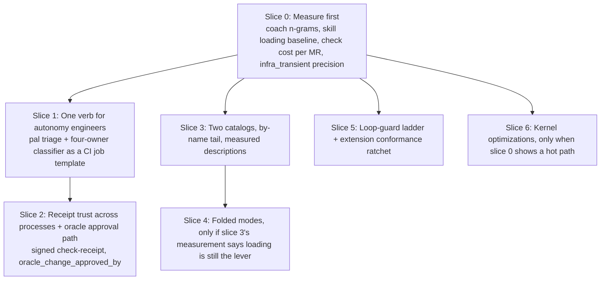

# Volume 7: Design Review, Lessons Applied, Claims Ledger & Revised Roadmap

> **Scope:** A fresh read of Volumes 1 to 6 against the domain they serve and against what AgentOps learned the hard way in 2026. Written outside the work environment from the sanitized packet plus a short domain brief. The target system is the governed pi harness (skills, the Rust `pal` kernel, the TypeScript host extensions). AgentOps is the review site, not the destination. Where this volume disagrees with Volume 6, this volume wins on ordering; Volume 6 keeps the mechanism detail.
>
> **How to read it:** Section 1 is the verdict. Sections 2 and 3 are the design review and the lessons. Section 4 is the claims ledger. Section 5 is the roadmap to carry back. Section 7 lists what the author could not know from outside.

---

## 0. The domain and its two populations

The harness serves one team and one customer group, and they adopt tools differently.

| Population | Stack | Working style | What they will adopt |
| --- | --- | --- | --- |
| **Platform team** (the authors) | Ansible, CI/CD, Helm, Terraform, Kubernetes on a hyperconverged virtualization platform, container builds | XP mobbing; one driver, shared screen, frequent rotation | A harness with skills and modes. They will learn pi, read folded modes, and tolerate a governance layer because they wrote it. |
| **Autonomy engineers** (the customers) | C++17 real-time apps, Python analysis, batch test campaigns, HPC compute | Not mobbing; individual engineers under delivery pressure; a REPL-and-rerun loop | A faster loop they already run. They will not read a skill catalog. They will run one command in CI or at the shell if it tells them, inside the pipeline's existing time budget, which of four owners their failure belongs to. |

Most of the packet's weight (folded modes, 67 skills, the placement gate, the corpus) is built for the first population. Most of the leverage for the organisation is in the second, and for them the product is the zero-token kernel, not the harness. The roadmap in Section 5 is ordered on that.

---

## 1. Verdict in one screen

**What is strong and should be kept as designed**

1. The proof-carrying check receipt with a recomputed contract digest, the pre/post subject bracket, and the per-commit protected-oracle audit (Vol 4 §1.1 to §1.5). This is the best anti-reward-hacking mechanism in the packet and it is already built.
2. The zero-token read path: one call binds a six-part snapshot, runs the fault tree, classifies infra-transient against step boundaries, and re-fetches to detect a moved subject (Vol 3 §1.2, Vol 4 §2).
3. Fail-closed engineering throughout: `Verdict` has no `Default`, unknown status parses to `Open` (Vol 2 §1, §2), cohort ranking is suppressed below the minimum cardinality (Vol 2 §5, Vol 4 §3.1), egress aborts before it throws (Vol 3 §3.1).
4. The loop guard's call-plus-result fingerprint, which does not punish legitimate polling (Vol 3 §3.2).
5. Volume 2's gap matrix, which separates what is live from what is a target. It is the model the rest of the packet should follow.

**What is weak and should change**

1. **The roadmap is aimed at the wrong system.** Volume 6 adds six slices of CLI surface to AgentOps. AgentOps' product boundary excludes Git landing, cherry-pick integration, queues and leases (`PRODUCT.md`, "What AgentOps does not own"), and its maintainer decided in October 2026 to retire the Go CLI (a decision recorded in working notes, not yet landed in the repository, whose product docs still describe `ao`). The mechanisms belong in `pal` and the pi extensions, where they already live. Section 5 re-targets them.
2. **The skill layer is designed by inventory, not by measurement.** Sixty-seven skills and ninety folded modes on the pi side with no loading or outcome data, and (for AgentOps, Vol 6 slice 6) a target of "root `SKILL.md` under 120 lines, token footprint down 60%" that is an input, not an outcome. AgentOps measured a 32-skill catalog for a month (`docs/evals/2026-10-22-plugin-eval-opus-5-5.md`): the 3.11 release, which added three skills and changed 28 of 29, measured level on content and worse on loading (104/150 vs 62/75, p = 0.037) with no tested cause explaining it; quiet routing worked for 16 of 28 skills, only sometimes for 7, and never for 5; skills whose descriptions say "use only when named" loaded on 22 of 24 requests that named them and, by design, on 0 of 72 that did not; cutting nine listing entries did not restore loading; and description changes moved loading only in a same-day controlled trial, where 6 of 11 candidates were null. Measure before restructuring, in either direction.
3. **One wording gate is load-bearing.** `VA-1` blocks the words "proven / validated / confirmed / works" when no receipt backs them. A wording rule is a meaning judgment dressed as a deterministic check; AgentOps spent six review rounds on one public-copy gate before deleting it (recorded in the maintainers' notes). Check for the receipt's presence, not the word.
4. **Headline numbers lack denominators**, which the packet's own `RH-10..17` forbids. Section 4 lists each one with its status.
5. **"Unforgeable" is true inside one process.** The `Symbol` brand and the private `Map` make a receipt unforgeable within the Node process that minted it. A receipt that crosses a process boundary (CI job to promotion gate, kernel to extension) is only as strong as its digest. Say which, and sign it where it has to travel.
6. **Volume 5 fails the packet's own 4-Part Creation Gate.** A hand-written encyclopedia of 67 skills has no consumer that branches on it, no gate it protects, and no retirement trigger. The registry check that already enforces single-home placement should generate it.

**What this volume adds:** a two-population framing, a slice 0 that measures before the thresholds are set, a decision rule for when a fresh model read is worth its cost, and a short list of what flows back into AgentOps.

---

## 2. Design review by locus

Each item follows the shape: friction located, proposal, alternatives including "leave it", risk, strength. Strength is `recommend` when the friction is located and the first step is reversible, `consider` when the pain is real but the shape should be probed first, and `note` when it is a signal without demonstrated pain.

### 2.1 Locus 1: skills, folded modes, corpus

**Proposal 1.1: Two catalogs by audience, the rest by name only.**
- *Friction:* 67 skills in one registry (Vol 5). In the AgentOps 3.11 plugin eval, quiet routing failed outright for 5 of 28 skills and was unreliable for 7 more, the misses loaded no skill at all rather than a rival, and by-name skills were the one reliable path (22 of 24). Whether listing size itself drives the misses is a hypothesis the eval could not confirm. Fifteen of the infrastructure skills (Vol 5 §2.6) and all eight robotics skills (§3.1) are domain playbooks a platform engineer picks by name; they do not need to compete for quiet routing.
- *Proposed:* a platform-team catalog of roughly 20 quiet-routed skills, a robotics catalog of under 10, and everything else marked by-name only (description says "use only when named"; check pi's listing mechanics first, since an unlisted skill may be reachable only by slash command). Measure loading on blind requests before and after.
- *Alternatives:* merge roots further so the listing shrinks: cheaper to list, but one AgentOps dose test could not separate entry count from characters, and removing nine entries did not restore loading, so a smaller listing alone is not the fix. Leave it: the autonomy engineers never see the catalog anyway, so the cost lands on the platform team only.
- *Risk:* by-name skills stop being discovered by new team members. Mitigation: the onboarding skill names them.
- *Strength:* recommend.

**Proposal 1.2: Measure the folded structure instead of asserting it.**
- *Friction:* the pi skills are already folded (90+ `modes/*/mode.md`, Vol 5), and nothing in the packet says whether the right mode gets opened when a task needs it. Vol 6 slice 6 then exports the same shape to AgentOps with "root `SKILL.md` under 120 lines, token footprint down 60%" as acceptance; neither is an outcome. AgentOps' 3.11 restructure (three skills added, 28 changed) measured level on content and worse on loading against the previous release, which is what an unmeasured restructure looks like after the fact.
- *Proposed:* pick the three pi skills with the most modes. For each, run the headless evaluation suite (Vol 5 §2.5 `headless-validation`) in two arms, folded as today and flattened into one file, with the same cases, the same model, alternating launch order, and all-attempt denominators; also record, in the folded arm, how often the needed mode file was actually opened. Acceptance for keeping the fold: loading and criteria met not worse, mode-open rate reported. Apply the same two-arm demand to the AgentOps fold before Vol 6 slice 6 runs.
- *Alternatives:* keep folding by taste and watch for complaints (the current state). Leave it.
- *Risk:* the eval costs model spend. Budget it before the run; AgentOps' comparable trials cost about two dollars per 13-run arm.
- *Strength:* recommend.

**Proposal 1.3: Replace `VA-1`'s word list with a receipt check.**
- *Friction:* Vol 1 §2.4. Blocking "proven / validated / works" catches true sentences ("the test proves the parser rejects BOM") and misses paraphrases ("behaves correctly in all cases"). Every fresh reviewer can construct the next edge case, so the rule is an unbounded finding generator.
- *Proposed:* `VA-1` becomes structural, with no reading of the prose: every spike or issue in a "validated" or "ready" state must cite at least one receipt id, CI job URL, or validation rung, and the deterministic check verifies each citation resolves. Whether the receipt covers the claim is the reviewer's job, and that is a narrower job than reading for adjectives.
- *Alternatives:* keep the word list as a `WARN` only. Leave it and absorb the false positives.
- *Risk:* authors cite a receipt that does not cover the claim. The reviewer catches that; the check no longer pretends to.
- *Strength:* recommend.

**Proposal 1.4: Generate Volume 5 from the registry.**
- *Friction:* 300 hand-written lines that drift the day a mode is renamed. `registry-check` already enforces single-home placement (Vol 5 §1.1), so the data exists.
- *Proposed:* one `pal registry render --markdown` projection; the encyclopedia becomes a build artifact and the prose sections (placement gate, resolution order) stay hand-written and short.
- *Alternatives:* keep hand-writing and add a freshness check. Leave it.
- *Risk:* none worth naming; reversible at every step.
- *Strength:* recommend.

**Proposal 1.5: Corpus freshness is proven; corpus value is not.**
- *Friction:* the code-anchored corpus with `file:symbol` anchors and staleness exit codes (Vol 6 §2.2) is good engineering. AgentOps built a different corpus (lessons mined from review escapes, not symbol-anchored rules) and recorded in two ADRs that its mechanism was proven and its compounding was unproven, not disproven: catches at review were plentiful, learning from catches measured null, and the corpus starved because escapes, the misses, were rare at frontier quality (ADR-0004, ADR-0011).
- *Proposed:* keep the anchor check. Add one counter: how often a corpus rule is retrieved and changes an outcome (a blocked diff, a corrected plan). Review the counter quarterly; archive rules with zero hits.
- *Alternatives:* assume value from staleness-freedom. Leave it.
- *Strength:* consider.

### 2.2 Locus 2: the Rust kernel

**Proposal 2.1: One verb is the product for the autonomy engineers.**
- *Friction:* the pieces an autonomy engineer needs are spread across three loci: `mr_validate` and the `BA101..BA602` rules in the Python workbench (`robotics_check.py`, Vol 4 §4), `validate`, `graph` and `coach` in the Rust kernel (Vol 2 §4), the Loki/Tempo correlation join in the networked, credentialed cluster broker (Vol 4 §3.2), and the four-owner classification (`Dev Code | Dev Config | Simulation Framework | IT Platform`) only as a model-run skill (`batch-ci-diagnostics`, Vol 5 #48). An engineer under delivery pressure needs one command and one answer.
- *Proposed:* `triage <mr | job | log>` as one stable entry point with `--json` and a 2 KB decision pack, built in two layers. The deterministic layer runs with no harness and no network: `mr_validate`, the BA rules, and a new rule table that maps deterministic signals (which plane failed, which rule fired, whether the failure is in `step_script`) to an owner or to `unknown`; it ships first as a CI job template and a shell alias. The second layer, the Loki/Tempo join, needs cluster credentials and runs only where they already exist: as a CI job step, not inside the sandboxed kernel. The model-run skill stays for the cases the rule table returns `unknown`.
- *Alternatives:* teach pi to that population (they will not adopt a governance layer they did not write). Leave the pieces where they are and rely on skills to compose them (the skills are for the other population).
- *Risk:* the rule-table classifier is wrong often enough to lose trust, or returns `unknown` so often that nobody reads it. Mitigation: log every classification with the later human verdict and publish the confusion matrix and the `unknown` rate monthly; the model skill's answers feed new rows into the table.
- *Strength:* recommend.

**Proposal 2.2: Decide whether receipts may cross a process boundary, and sign them if so.**
- *Friction:* Vol 4 §1.1 verifies the `Symbol` brand and presence in a private in-memory `Map`, so a receipt that arrives from another process fails closed as `not_proven`. That is safe and it is also a limit: a promotion job, or any gate that did not mint the receipt, cannot consume one at all. Vol 6 §2.1's `check-receipt.v1` JSON would be the carrier, and a JSON file is only as trustworthy as its digest plus whoever could write it.
- *Proposed:* if cross-process trust is wanted, the host extension that mints the receipt (`check-evidence.ts`, Locus 3, outside the sandbox) signs the canonical receipt with an asymmetric key; the promotion job verifies with the public key and recomputes the contract digest. Symmetric MAC is not enough, because any job that can verify could also forge. If cross-process trust is not wanted, keep the current in-process design and change "unforgeable" to "unforgeable within the minting process". Name key custody explicitly (see §7).
- *Alternatives:* the two above are the alternatives; "leave it" is the second one with the word unchanged.
- *Risk:* key custody is an operational burden in the regulated profile. That is a real cost; honest wording is acceptable if the key is not.
- *Strength:* recommend one of the two; do not leave the word as it is.

**Proposal 2.3: Protected-oracle edits need an authorized path, not only a refusal.**
- *Friction:* Vol 4 §1.3 blocks any "unapproved" edit to `tests/`, CI templates, and checker scripts, but the packet never says what approval is or where it is recorded. Tests legitimately change. If the path does not exist, agents stop touching tests at all and narrow scope instead (the `RH-4..9` refusal-farming shape); if it exists but is not in the receipt, a reviewer cannot see that an oracle changed under approval.
- *Proposed:* make the approval explicit and visible: a human-held token on the MR or bead (`oracle_change_approved_by`) that the audit requires for protected paths and records in the receipt with the assertion delta. The audit still runs its assertion-drop and skip checks and reports them; approval acknowledges, it does not silence.
- *Alternatives:* allow test additions, block only deletions and skips (cheaper, catches most of `RH-1`). Leave it.
- *Strength:* recommend.

**Proposal 2.4: Age the fingerprint baseline.**
- *Friction:* Vol 4 §4.1. A `.lint-baseline.json` of 16-hex fingerprints grows forever, and a fingerprint keyed on `rule_id | path | normalized snippet` survives as long as the snippet does. Legacy findings become permanent.
- *Proposed:* each baseline entry carries the commit that admitted it and expires after N touches of its file; expired entries fire again as warnings for one release, then as blocks.
- *Alternatives:* leave the baseline permanent and review it by hand yearly.
- *Strength:* consider.

**Proposal 2.5: Defer the Gauntlet optimizations.**
- *Friction:* Vol 2 §6 lists CSR adjacency and `FixedBitSet` masks as targets, and §3 lists `as_chunks` elision as a pattern; none is tied to a measured hot path anywhere in the packet. The packet's own Opportunity Matrix (score at or above 2.0 with an isomorphism proof) applies here.
- *Proposed:* no work until the coach n-gram data (slice 0) shows graph queries in the top friction sequences or a p95 query time above a stated budget.
- *Strength:* recommend (as a deferral).

**Note 2.6:** the descriptor-pinned reader and the process-group reaper (Vol 2 §2.2, §2.3) are correct and complete. The one durability addition the gap matrix already lists, parent-directory `fsync` after `rename()`, belongs to `atomic_write_private` (SYS-04), not to these two.

### 2.3 Locus 3: the pi host extensions

**Proposal 3.1: Map the loop guard to an escalation ladder.**
- *Friction:* Vol 3 §3.2 nudges at streak 3, blocks at 4, hard-stops after 5 ignored blocks. Each rung is "the same model, again". AgentOps' charter (ADR-0017) settled on a three-rung ladder: direct repair, then at most one bounded fresh helper context for that incident, then a human. An unhelpful helper answer ends the attempt and hands the state to a person; there is no sixth retry and no helper chain.
- *Proposed:* on the first hard block, spawn one fresh context with the last 16 events and the block reason, asking one question. If it does not produce a different next call, stop the turn and write the handoff. Never a second helper.
- *Alternatives:* leave the five-strike rule.
- *Strength:* recommend.

**Proposal 3.2: Extension growth gated by the conformance suite only.**
- *Friction:* Vol 5 §2.5 `extension-conformance` audits mode-gating, shell-free `execFile`, redaction, and schema completeness. Extensions are where credentials and network live, and the count will grow with every new broker.
- *Proposed:* a new extension registers only when its conformance tests pass in CI, including the abort-before-throw ordering test from Vol 3 §3.1. Keep a count ratchet: the number of extensions that touch the network cannot rise without a recorded decision.
- *Strength:* recommend.

**Note 3.3:** `sqz` (Vol 4 §1.7) is well designed: secrets first, valid JSON untouched, errors and diffs preserved. The one risk is a template collapse hiding the line the agent needed; the "errors untouched" rule covers it. Keep the 64 KiB scan window as a stated bound and report when it is hit.

**Note 3.4:** zero-token pipeline watch with `fail_fast` and the section-scoped infra-transient classifier (Vol 4 §2) is the right shape for a regulated GitLab. Record the false-positive rate of `infra_transient` against later human reruns; that number decides whether `NOT_PROVEN` on a transient should auto-retry once.

### 2.4 Cross-cutting: where judgment is worth its cost

The factory runs sandboxed checks on every wave and mints a receipt. That is cheap and should stay universal. A model-based review of the diff is not cheap, and the packet does not say when it is owed. AgentOps moved to conditional review in ADR-0017 because review cost was exceeding the cost of the work and review-plus-revalidation loops did not converge; the ADR claims no measured quality effect. Its maintainers' working notes also record a refute rate near 3% on routine diffs from an internal meter, a figure that lives outside the repository and should be read as supporting, not founding.

Rule to adopt: for an ordinary change the receipt and CI are the gate. One fresh, author-distinct read is owed only when the caller asks, when the change cannot be cheaply undone after it lands (a promotion into the regulated environment, an edit to a protected oracle, a deletion of a check, a credential or egress change), or when no deterministic check covers the changed behavior. One round, one question, no re-running of checks. A repair after that read is confirmed by a check, not by another read.

This maps onto the packet's own `promotion-gate` and `PL-5`: `PL-5`'s fresh judge is the costly-door reviewer, not an every-MR reviewer.

---

## 3. AgentOps lessons applied

Each row names a lesson AgentOps paid for, where the packet is exposed to the same failure, and the change.

| Lesson (what happened in AgentOps) | Where the packet is exposed | Change |
| --- | --- | --- |
| Wording gates never converge; reviewers construct the next edge case forever (six review rounds on one public-copy gate, recorded in the maintainers' notes, not in the repo). Fixed by deleting word rules and checking facts. | `VA-1`, `SC-1..4`, the `noslop` check in `documentation/specification` | Check for the receipt or the structure; leave meaning to the reviewer (Proposal 1.3). |
| Quiet routing failed for 5 of 28 skills and was unreliable for 7; by-name skills loaded 22 of 24 times when named; cutting nine entries did not restore loading, and whether listing size drives the misses is unconfirmed. | 67 skills, Vol 6 slice 6 | Two catalogs by audience, the rest by-name; do not sell a listing cut as a loading fix (Proposal 1.1). |
| Content measured level while loading measured worse after a restructure that added three skills and changed 28, with no tested cause. | pi's existing fold; the AgentOps 60% target | Measure the folded structure with two arms, in both systems (Proposal 1.2). |
| Description changes only moved loading in a same-day controlled trial with a fixed rule written first; most candidates were null. | Trigger phrases across Vol 5 | Trial descriptions with a control; write the rule and the spend cap before the run. |
| The corpus mechanism was proven and compounding was unproven, not disproven; a corpus fed by review escapes starved because escapes were rare at frontier quality. | `.agents/corpus/`, `ao corpus verify` | Keep freshness; count retrievals that changed an outcome (Proposal 1.5). |
| A fail-open helper (`|| true`, a dead subprocess) reads as "no findings". | `sqz` spill, `codemode` cancellations, pipeline-watch abort on mode change | Every helper death is `not_proven`, never empty-pass; the packet mostly does this already; make it a conformance test. |
| A gate that validates the worktree, not the commit, misses what landed. | Already handled: per-commit oracle audit | Keep; it is the right answer. |
| One unhelpful helper answer ends the attempt; retries past that burn budget and trust. | Loop guard's five-strike rule | Three-rung ladder: direct repair, one fresh helper, human (Proposal 3.1). |
| Thresholds invented before data contradicted the measurement they were meant to use. | `cohort_diff` 25% throttling, `min_cohort_size = 3`, `max_pipelines = 20`, Little's Law `L <= 1..2` | Slice 0 collects two weeks of data before any threshold is promoted from default to rule. |
| Every eval and metric needs an all-attempt denominator and a countermetric. | Vol 3's `136x`, `427 sessions`, Vol 2's `>10 GiB/s` | Claims ledger (Section 4). |
| Process artifacts earn no credit; name the consumer, gate, defect, retirement before creating one. | Vol 5 encyclopedia, Vol 6's ten registry slugs and two contracts | Generate Vol 5; park the slugs and contracts unless an AgentOps consumer appears (Section 5, Parked). |
| Deterministic checks prove facts; a fresh context judges meaning; the author's context cannot issue its own PASS. | `software-review/acceptance`, `PL-5` | Already aligned; adopt the costly-door rule for when the fresh read is owed (§2.4). |
| A second model family caught public-copy errors the first family passed (maintainers' notes, not in the repo); it earns its keep on outward-facing text and security boundaries. | Regulated promotion, egress policy, anything published to the autonomy engineers | Use a second model family on exactly those; not on routine diffs. |

---

## 4. Claims ledger

Status: **Measured** means the packet or its source gives a reproducible method and a denominator; **Claimed** means a number is stated without them; **Library** means the figure belongs to a dependency's published benchmark; **Design constant** means a bound the code enforces, which is neither measured nor claimed until its hit rate is observed; **Target** means the packet presents it as acceptance rather than observation. The last column says what would move each row to Measured.

| Claim | Where | Status | To make it Measured |
| --- | --- | --- | --- |
| Two-tier equivalence join: `98,318 ms -> 720 ms` (`136x`) | Vol 3 §1.2, Vol 5 §2.6 | Claimed | One repository, one run each? State repo size, file count, cold vs warm cache, runs per arm, and the median. |
| `427` sessions, `59,725` tool events mined for 3-grams | Vol 3 §1.2 stage 4 | Claimed (as a count) | A count is fine; the missing number is how many 3-grams were crystallized into tools and what the loop count did afterwards. |
| Aho-Corasick fast path `> 10 GiB/s` | Vol 2 §3 | Library | Measure `pal`'s own scan on its own corpus; report bytes, time, and the share of files that skip the regex pass because of it. |
| `5 ms` reaper poll, `1 s` kill grace | Vol 2 §2.3 | Design constant | Already a stated constant; add the observed p99 time-to-reap on a leaked grandchild. |
| 16-event window, periods `1..4`, nudge at 3, block at 4 | Vol 3 §3.2 | Design constant | Report false-nudge rate on legitimate polling over a month. |
| `256` calls, `8` concurrent, `8 MiB` outstanding, `16 MiB` output | Vol 3 §2 | Design constant | Report how often each cap is hit; a cap never hit is a cap set wrong. |
| `infra_transient` only on a runner `failure_reason` or an infra pattern inside the five pre-script sections | Vol 4 §2 | Design constant (a rule) | Report precision against later human reruns (Note 3.4). |
| Root `SKILL.md` token footprint down `> 60%` | Vol 6 slice 6 | Target | Two-arm eval (Proposal 1.2). A footprint is an input, not an outcome. |
| "Unforgeable" receipts | Vol 4 §1.1 | Claimed (true in-process) | Sign for cross-process trust or qualify the word (Proposal 2.2). |
| Opportunity Matrix score `>= 2.0` | Vol 1 §2.1, Vol 2 §5 | Target (heuristic) | Fine as a heuristic; do not report it as a measurement. |
| Review WIP `L <= 1..2` per pair | Vol 2 §5 | Target (heuristic) | Record merge throughput and open-PR count for a month; set the cap from the data. |

---

## 5. Revised roadmap for the pi harness

Replaces Volume 6 §3 as the order of work. Volume 6's slices keep their mechanism detail; the write scopes below name pi-harness paths generically because the real ones are behind the wall. Every slice carries the 4-Part Creation Gate (consumer, gate, observed defect, retirement) and a countermetric, because the packet's own rule demands it and because it is how a slice gets refused when it should be.

### Slice 0: Measure first (two weeks of data, no thresholds promoted before it)
- **Consumer:** every later slice's acceptance. **Gate:** nothing ships a threshold without it. **Observed defect:** the packet sets targets and thresholds with no baseline: 60% (Vol 6 slice 6), the 2.0 opportunity score (Vol 1 §2.1, Vol 2 §5), 25% throttling and a cohort floor of 3 (Vol 2 §5). **Retirement:** when the dashboards below exist in the harness's own telemetry.
- **Work:** turn on `coach report` 3-gram mining for all sessions; record skill loads per blind request by population; record check wall-time and sandbox cost per MR; record `infra_transient` classifications and the later human verdict; record loop-guard nudges and blocks with whether the next call changed.
- **Acceptance:** Given two weeks of sessions, when the report runs, then it prints the top ten tool 3-grams with counts and error rates, the skill load rate per catalog with all-attempt denominators, the cost per receipt, and the infra-transient confusion matrix, without any threshold being set from a single run.
- **Countermetric:** telemetry volume per session stays under a stated bound; if measuring costs more than 2% of session tokens, the measurement is wrong.

### Slice 1: One verb for the autonomy engineers
- **Consumer:** the autonomy engineers' MR pipeline and their shell. **Gate:** their batch-test failure triage. **Observed defect:** the current loop is "rerun, read a log, ask the platform team"; the platform team is the Brent in the packet's own Theory of Constraints framing. **Retirement:** when the four-owner classification is read from CI by default and the question count to the platform team drops.
- **Work:** a `triage` entry point with a `--json` decision pack under 2 KB, in two layers (Proposal 2.1). Layer one, no harness and no network: `mr_validate` and the `BA101..BA602` rules from the Python workbench plus a new deterministic owner rule table that returns one of the four owners or `unknown`. Layer two, where cluster credentials already exist: the Loki/Tempo correlation join as a CI job step. A CI job template runs both on every MR and posts the pack as a note; a shell alias runs layer one locally. The model-run `batch-ci-diagnostics` skill stays for `unknown`.
- **Acceptance:** Given a failing batch job on an MR, when the template runs, then the note names one owner or `unknown`, the failing check, the smallest reproduction (`ctest -R` regex, `pytest` path, or job id), and the receipt id, within the pipeline's existing time budget (layer one alone under a few seconds locally), without widening the MR's write scope or requiring the engineer to install anything.
- **Negative invariant:** without ever classifying a `step_script` failure as `infra_transient`.
- **Countermetric:** classification precision against human reruns and the `unknown` rate, published monthly; precision below a stated floor pauses any blocking mode, and an `unknown` rate above a stated ceiling means the rule table is not earning its place.

### Slice 2: Receipt trust across processes and the oracle approval path
- **Consumer:** the regulated promotion gate and the per-commit oracle audit. **Gate:** promotion into the regulated environment. **Observed defect:** a receipt cannot be consumed by any job that did not mint it, so a promotion gate in another process has nothing to verify; the oracle gate's approval path is unnamed in the packet and invisible in the receipt. **Retirement:** when every promotion decision cites a verified signed receipt and the split-MR pattern stops appearing in the weekly merge review.
- **Work:** either an asymmetric signature over the canonical receipt by the minting host extension, verified with the public key in the promotion job alongside a recomputed contract digest, or a recorded decision that receipts stay in-process and the word "unforgeable" is qualified; `oracle_change_approved_by` recorded on the bead or MR, required by the audit for protected paths, and carried in the receipt; the audit keeps reporting assertion drops and skips under approval.
- **Acceptance:** Given a receipt copied from one CI job to the promotion job with one byte changed, when the gate verifies it, then the result is `not_proven` with the signature or digest mismatch named, without the gate trusting any field it did not recompute or verify. Given a test deletion with a recorded approval, when the audit runs, then it passes and the receipt carries the approver and the assertion delta.
- **Countermetric:** approvals per week; a rising count with flat test additions means the token is being rubber-stamped.

### Slice 3: Two catalogs and a by-name tail, with measured descriptions
- **Consumer:** the routing layer and the onboarding skill. **Gate:** skill loading on blind requests. **Observed defect:** AgentOps' finding that listing length crowds out loading and quiet routing fails where by-name succeeds; the packet lists 67. **Retirement:** when blind-request loading for the platform catalog is at a stated floor for a month.
- **Work:** classify each skill as platform-quiet, autonomy-quiet, or by-name; cut listing entries accordingly; trial each changed description with a same-day control and a rule written first.
- **Acceptance:** Given the slice 0 baseline, when the two catalogs ship, then blind-request loading is not worse for any skill and better for at least one per catalog, with all-attempt denominators, without any skill being removed from by-name invocation.
- **Countermetric:** by-name skills that are never invoked in a quarter are candidates for archiving, and the count is reported.

### Slice 4: Folded modes, conditional
- **Precondition:** slice 3's measurement shows loading or outcome is still limited by root `SKILL.md` size. If slice 3 reaches its floor without this, slice 4 is retired unbuilt.
- **Work:** fold the three heaviest skills; two-arm eval as in Proposal 1.2.
- **Acceptance:** loading and criteria met not worse in the folded arm; footprint reported, not targeted.

### Slice 5: Loop-guard ladder and extension conformance ratchet
- **Consumer:** the governance broker and the extension registry. **Gate:** every extension load; every hard block. **Observed defect:** five strikes of the same context; extensions grow without a count. **Retirement:** when hard stops are rare enough that the helper rung fires less than once a week.
- **Work:** one bounded fresh helper on first hard block, then stop and hand off; conformance suite as the only registration path; network-touching extension count ratchet.
- **Acceptance:** Given a repeated blocked call, when the guard arms, then exactly one fresh context is consulted and the turn ends with a written handoff if the next call does not change, without a second helper. Given a new extension whose abort-before-throw test fails, when registration runs, then it is refused with the test name.

### Slice 6: Kernel optimizations, conditional
- **Precondition:** slice 0 shows graph or validate queries in the top three friction 3-grams, or a p95 above a stated budget. Otherwise retired unbuilt.
- **Work:** the Volume 2 §6 targets (CSR adjacency, parent-dir `fsync`, atomic multi-file apply, `scip` symbol tables), each with an isomorphism proof and the Opportunity Matrix score recorded.

### Parked, with the reason
- **Ten `PRACTICE-REGISTRY.md` slugs and two AgentOps contracts (Vol 6 §1, §2):** no AgentOps consumer; the receipt overlaps `subject-manifest.v1` plus `verdict.v2`. Revisit if an AgentOps skill needs to cite them.
- **Vol 5 as prose:** generate it (Proposal 1.4).
- **Zero-token write path for the autonomy engineers (`--fix`, codemod):** valuable, but second to triage; an engineer who trusts the triage will accept the fix, not the other way round.

---

## 6. What flows back into AgentOps

The valve runs both ways, but the AgentOps side should take knowledge, not machinery. Candidates, each small:

- The protected-oracle diff signatures (net assertion drop, tautological asserts, new skips, CI gate line deletion, out-of-scope writes, per-commit audit) as one deterministic check script on a PR diff. AgentOps has the rule "never obtain green by weakening acceptance", a blocking test-count regression check and an advisory tightening ratchet, but no detector for assertion drops, tautologies or new skips on a general diff.
- The `RH-1..17` and `PL-1..5` names into the Validate and Review skills as vocabulary.
- The pre/post subject bracket into Validate's subject identity.
- The abort-before-throw test lesson into the Test skill as an example of a non-discriminating test.
- The four adversarial review lenses and three-pass convergence into Review; the Two-Horizon walking skeleton into Plan; the five-question placement gate into Skill Builder.

Everything else in the packet stays on the pi side.

---

## 7. What the author could not know, and who holds it

These are behind the wall. Each one changes a recommendation above if the answer differs from the assumption.

1. **Key custody for signed receipts (Proposal 2.2).** Assumed: the minting host extension can hold a private key the sandbox and the CI jobs cannot read, and the promotion job can hold the public key. If the regulated profile forbids that, take the honest-wording alternative and keep receipts in-process.
2. **Whether the autonomy engineers' CI is the same GitLab** the workbench targets (Vol 4 §2). Assumed yes. If their batch campaigns run under a separate scheduler, slice 1's template needs a second adapter and the HPC job id becomes the primary key.
3. **Whether pi may run on the autonomy engineers' machines at all.** Assumed no, which is why slice 1 needs no harness. If yes, a thin by-name entry (`/triage`) is a cheap addition after slice 1.
4. **The actual loading and loop data.** Slice 0 exists because none of it is in the packet. Every threshold in this volume is a default until that data arrives.
5. **The team's current review spend.** The costly-door rule in §2.4 assumes a fresh model read is expensive relative to a sandboxed check. If model spend is not the constraint there, the rule still holds for trust reasons but the economics argument weakens.
6. **Mobbing cadence versus the autonomy engineers' delivery rhythm.** The four-line handoff and the WIP cap are for the mob; nothing in this volume asks the autonomy engineers to change how they work, and that should stay true.
