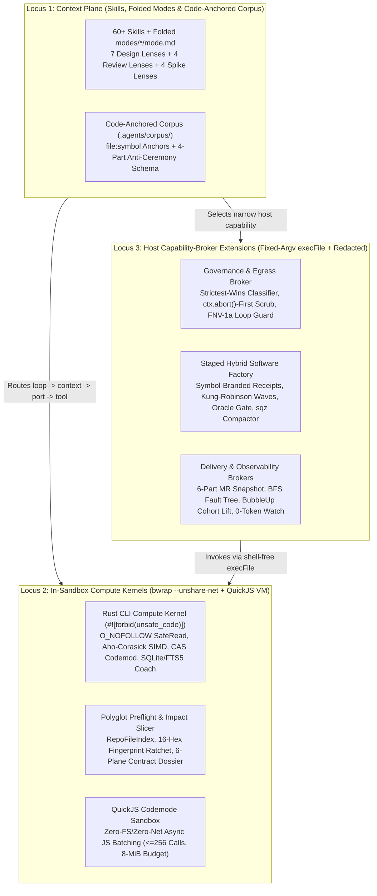

# Unified Harness, Rust Compute Kernel, Systems Metrics & Skill Encyclopedia (2026)

> **Purpose:** Exhaustive, source-verified, 100% sanitized engineering treatise capturing the algorithms, data structures, mathematical models, Rust systems-programming patterns, sandbox mechanics, Zero-Token data plane, Staged Hybrid Software Factory, and 60+ folded-mode skills developed across our production agentic tooling. Written for the governed pi harness (skills, the Rust `pal` kernel, the TypeScript host extensions) and reviewed in **AgentOps (`~/dev/agentops/`)**, which is the review site, not the destination. Volume 7 holds the design review and the roadmap to carry back; Volume 6's roadmap is kept for its mechanism detail and superseded on ordering.

---

## 1. Architecture Overview: The Three Execution Loci & Four Control Planes

---

## 2. Document Map (7 Volumes)

| Volume | Document | Core Technical Scope |
| --- | --- | --- |
| **Vol. 1** | [`01-seven-lenses-and-theoretical-foundations.md`](01-seven-lenses-and-theoretical-foundations.md) | **The 7 Architectural Design Lenses**, the **7-Step `*DD` + XP + DevOps Spine**, the **4 Adversarial Review Lenses** (with 3-Pass Convergence), the **4 Spike-Audit Lenses** (`VA/SA/DQ/SC`), the **8-Language Idiomatic & Reuse-First Matrix**, and the **Reward-Hacking & Proof-Laundering Catalog (`RH-1..17`, `PL-1..5`)**. |
| **Vol. 2** | [`02-rust-compute-kernel-and-systems-metrics.md`](02-rust-compute-kernel-and-systems-metrics.md) | **How We Use Rust (`pal-core`) & Systems Programming Metrics:** Crate-wide `#![forbid(unsafe_code)]`, `#[repr(transparent)]` newtypes (`ConfinedPath`, `FileId`, `NodeId`), descriptor-relative `O_NOFOLLOW` + double-`fstat` TOCTOU defense (`safe_read.rs`), `ProcessLimits` 5ms process-group reaper, `LazyLock<AhoCorasick>` SIMD fast paths, **Systems Cost Model (`SYS-01..05`)**, Gauntlet Patterns (`200..240`), Little's Law ($L = \lambda W$), Opportunity Matrix ($\ge 2.0$), CFS throttling math, and BubbleUp `cohort_diff` lift-ratio equations. Includes an explicit **Implemented vs. Target Gap Matrix**. |
| **Vol. 3** | [`03-zero-token-architecture-and-wasm-sandboxes.md`](03-zero-token-architecture-and-wasm-sandboxes.md) | **Zero-Token Data Plane & Multi-Layer Sandboxing:** The 4-stage Zero-Token Loop (`Read -> Write -> Staged Factory -> Graduate`), Tricorder base-vs-head multiset finding fingerprints with causal invalidation, two-tier incremental equivalence-class joins (`136x` speedup: `98.3s -> 720ms`), QuickJS WASM/VM `codemode` sandbox semantics, `bwrap` (`Regulated` vs `Commercial Lockdown`), `ctx.abort()`-before-`throw` egress ordering, and FNV-1a 32-bit sliding-window loop detection (periods `1..4`). |
| **Vol. 4** | [`04-staged-hybrid-software-factory-and-extensions.md`](04-staged-hybrid-software-factory-and-extensions.md) | **Staged Hybrid Software Factory & Host Extensions:** Deep source breakdown of `TrustedManagedCheckReceipt` (`Symbol` branding + SHA-256 `contract_digest`), `oracle-gate.ts` diff auditing, `deterministic-plan.ts` token-stream translation validation, `precomputed-wave.ts` Kung-Robinson read/write-set serializability, `candidate-integration.ts` per-commit assertion-deletion audits, `sqz` volatile log-template compaction, 6-part MR snapshot + BFS child-pipeline fault trees, output-contract cross-field assertions, and polyglot `BA101..BA602` checks. |
| **Vol. 5** | [`05-complete-skill-and-folded-mode-encyclopedia.md`](05-complete-skill-and-folded-mode-encyclopedia.md) | **Complete Encyclopedia of All 60+ Skills & Folded Modes:** Exhaustive technical reference for all **45 core platform skills** (including every internal `modes/*/mode.md`, `consumes -> produces` artifact edge, decision algorithm, and companion script), **8 polyglot robotics skills**, and **14 package-bundled runtime/SDK skills**. |
| **Vol. 6** | [`06-agentops-upgrade-roadmap-and-integration-spec.md`](06-agentops-upgrade-roadmap-and-integration-spec.md) | **AgentOps-targeted upgrade draft (superseded on ordering by Vol. 7):** 10 candidate `PRACTICE-REGISTRY.md` slugs, `check-receipt.v1` and `corpus-entry.v1` schemas, and 6 vertical slices with Given/When/Then + planted-negative acceptance criteria. Kept for the mechanism detail. |
| **Vol. 7** | [`07-design-review-lessons-applied-and-revised-roadmap.md`](07-design-review-lessons-applied-and-revised-roadmap.md) | **Design Review, Lessons Applied, Claims Ledger & Revised Roadmap:** the two user populations, a verdict on Volumes 1 to 6, proposals per locus in the architecture-review shape, thirteen AgentOps lessons applied, a ledger of every headline number with its evidence status, a measure-first roadmap for the pi harness, what flows back into AgentOps, and what the author could not know. |

---

## 3. Sanitization Verification

Verified clean (`exit 0`) against both `sanitize_and_export_check.py` and an extended strict identifier scanner (`0 hits` across all 7 Markdown files for organization names, internal domains, cluster aliases, project codewords, user home paths, or ticket IDs).

A second pass on 2026-11-08 replaced domain-specific product, framework and file-type names that the identifier scanner does not cover (middleware macro prefixes, IDL extensions, ontology class names, robotics log formats, platform bundle and overlay names) with generic equivalents. Rule IDs, algorithms and line references are unchanged.
